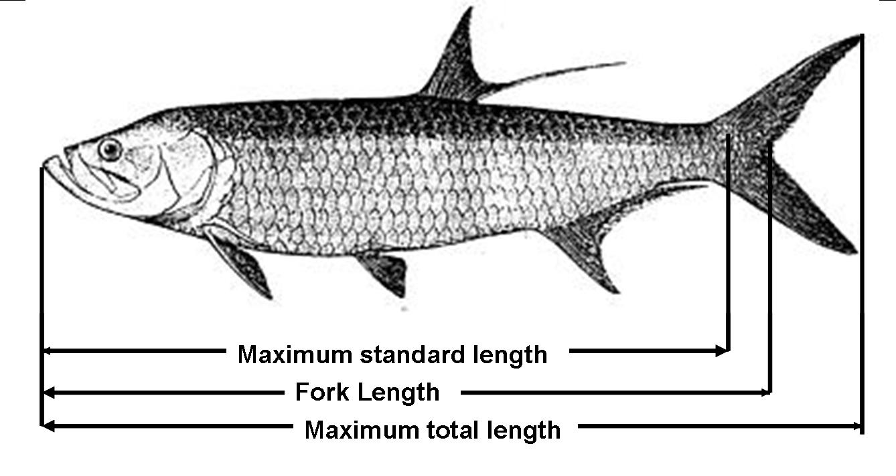

# Fish Weight Prediction Model:

## Установка Python и зависимостей

Для проекта используйте **Python 3.7.17**. Ниже приведены команды для Linux
и Bash. Python устанавливается отдельно от системного интерпретатора.

### Установка Python через pyenv

Если pyenv ещё не установлен:

```bash
git clone https://github.com/pyenv/pyenv.git "$HOME/.pyenv"
export PYENV_ROOT="$HOME/.pyenv"
export PATH="$PYENV_ROOT/bin:$PATH"
```

Перед сборкой Python установите системные зависимости для своей ОС по
[инструкции pyenv](https://github.com/pyenv/pyenv/wiki#suggested-build-environment).
Подробности установки pyenv: [официальная документация](https://github.com/pyenv/pyenv#installation).

Скачайте и установите Python; уже установленная версия будет пропущена:

```bash
pyenv install -s 3.7.17
PYENV_VERSION=3.7.17 pyenv exec python --version
```

### Создание окружения и установка пакетов

Из каталога `lab_2` перейдите в проект. Для первой установки создайте
окружение `.venv` именно на Python 3.7.17; если такое окружение уже существует,
шаг создания пропустите.

```bash
cd fish_weight_prediction_machine_learning
PYENV_VERSION=3.7.17 pyenv exec python -m venv .venv
.venv/bin/python --version
.venv/bin/python -m pip install -r requirements.txt
.venv/bin/python -m pip install "pytest==7.4.4"
.venv/bin/python -m pip check
```

`requirements.txt` устанавливает зависимости проекта, включая MLflow.
pytest устанавливается отдельно для запуска тестов. Все дальнейшие команды
используют `.venv` напрямую, поэтому активация окружения необязательна.

### Совместимость сохранённой модели

В `requirements.txt` закреплён scikit-learn 0.23.0, а сохранённая E4-B создана
с версией 1.0.2. Если нужно загрузить этот артефакт, после установки пакетов
установите соответствующую версию:

```bash
.venv/bin/python -m pip install "scikit-learn==1.0.2"
.venv/bin/python -m pip check
```

Это меняет установленную версию относительно `requirements.txt`.
Повторная установка зависимостей из этого файла вернёт версию 0.23.0.

## Запуск проекта, тестов и MLflow

Команды ниже выполняются из каталога
`lab_2/fish_weight_prediction_machine_learning`. Используйте Python 3.7 из
проектного окружения `.venv`: системный Python 3.14 несовместим с установленными
здесь пакетами Python 3.7.

```bash
.venv/bin/python --version
```

### Обучение и оценка моделей

Используйте сохранённое разбиение `src/split_indices.json`. Запуск E0 выводит
базовые прогнозы среднего и медианы; основной сценарий обучает E1–E4,
оценивает модели и сохраняет результаты в MLflow.

```bash
export MLFLOW_TRACKING_URI="file://$(pwd)/src/mlruns"
.venv/bin/python src/e0.py
.venv/bin/python src/run_mlflow.py
```

Для намеренного повторного создания разбиения:

```bash
.venv/bin/python src/split_data.py
```

### Паспорта моделей и ответы для защиты

Каждый новый запуск E0 (среднее и медиана), E1, E1-ln, E2, E3, E4-A и E4-B
сохраняет в MLflow → Artifacts → `документация/` два файла:

- `паспорт_модели.md`: параметры и метрики именно этого запуска, сведения
  об окружении, ограничения и ответы на вопросы по модели;
- `вопросы_и_ответы.md`: объяснение метода и контрольные вопросы лабораторной,
  включая утечку данных, отрицательный R², регуляризацию, причинность,
  сохранение модели и сдвиг распределения.

Для добавления этих документов к существующим успешным запускам без
повторного обучения и изменения метрик:

```bash
.venv/bin/python src/update_passports.py
```

Скрипт использует локальный журнал `src/mlruns`. Архивные и незавершённые
запуски не обновляются. Параметры и метрики берутся из конкретного запуска;
описание сетки поиска в ответах относится к текущему коду.

### Тесты

Если pytest ещё не установлен в проектном окружении:

```bash
.venv/bin/python -m pip install "pytest==7.4.4"
```

Запускайте только каталог `tests/` через интерпретатор окружения, чтобы
pytest не собирал тесты установленных библиотек из `.venv`:

```bash
PYTEST_DISABLE_PLUGIN_AUTOLOAD=1 .venv/bin/python -m pytest -q tests/
```

Только проверки пайплайна:

```bash
PYTEST_DISABLE_PLUGIN_AUTOLOAD=1 .venv/bin/python -m pytest -q tests/test_pipeline.py
```

### Интерфейс MLflow

В отдельном терминале из каталога проекта:

```bash
.venv/bin/mlflow ui --backend-store-uri "$(pwd)/src/mlruns" --host 127.0.0.1 --port 5000
```

Откройте <http://127.0.0.1:5000>. Обучение и интерфейс используют один каталог
`src/mlruns/`, где находятся сохранённые эксперименты. Остановка — `Ctrl+C`.
Также можно запустить `bash run_mlflow_ui.sh`, который открывает браузер.

Сохранённая E4-B создана с scikit-learn 1.0.2. Её загрузка в окружении
с другой версией может завершиться ошибкой; для воспроизведения старого
артефакта требуется совместимое окружение.



## Requirements

Hello! Welcome to the famous Tsukiji fish market of Tokyo, Japan! We came here to collect data on some of the fish they have here 
but we didn't wake up at 5am for the tuna auction and by the time we showed up they were only left with a few species of fish. 
We got to work and gathered measurements from a few different species of fish and want you to train a regression model to predict
the weight of a fish using some of the features we were able to measure. We have no idea which features will be good predictors. 

We will hold out 30% of the data before we hand it to you and we will use that csv for scoring.

Here's what we need from you:
1. A function that accepts a csv path and returns the predictions of your regression model using our csv. The csv we use will contain all the columns. 
2. Use a pipenv and scikit learn to submit the final model. You may use R for model selection. 

With this function and it's output, we will rank the students by how well their model performed on predicting weight based on naive data. 
Your grade will be determined by ranking according to Mean-squared Error.
If your function does not return a list of predictions or we cannot compute the accuracy of your model that it will be an automatic F. 

## Used

*   Linear Regression
*   Lasso Regression
*   Random Forest
*   Scikit Learn
*   Python
*   Joblib
*   Matplotlib
*   Virtualenv

