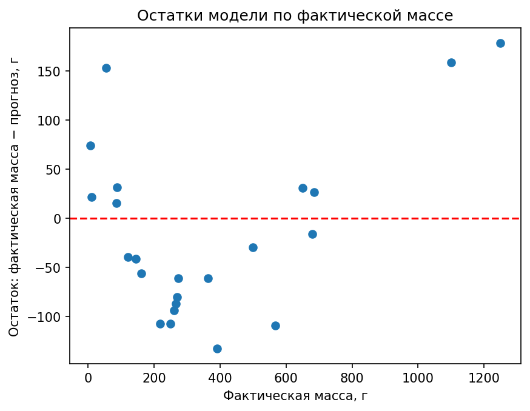
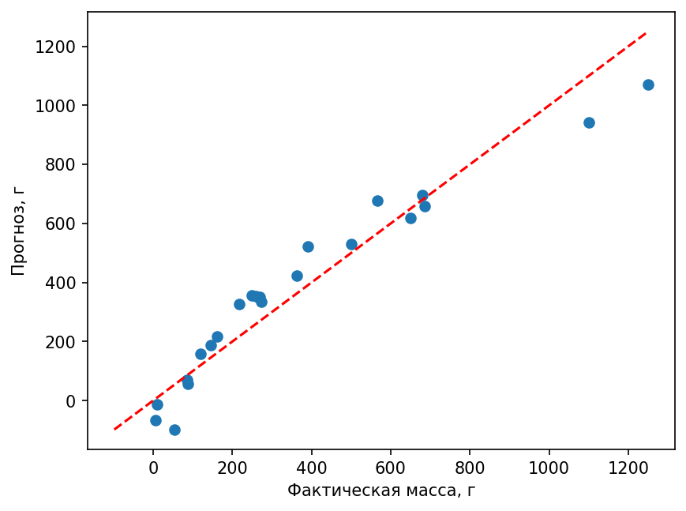
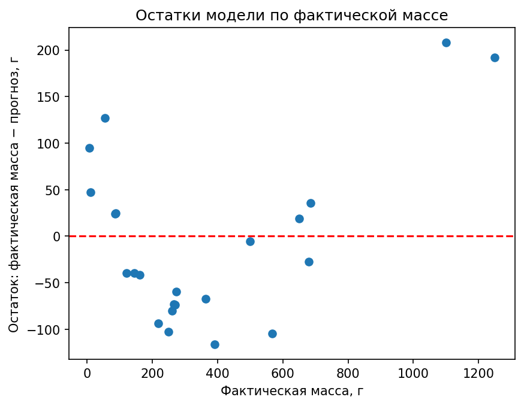
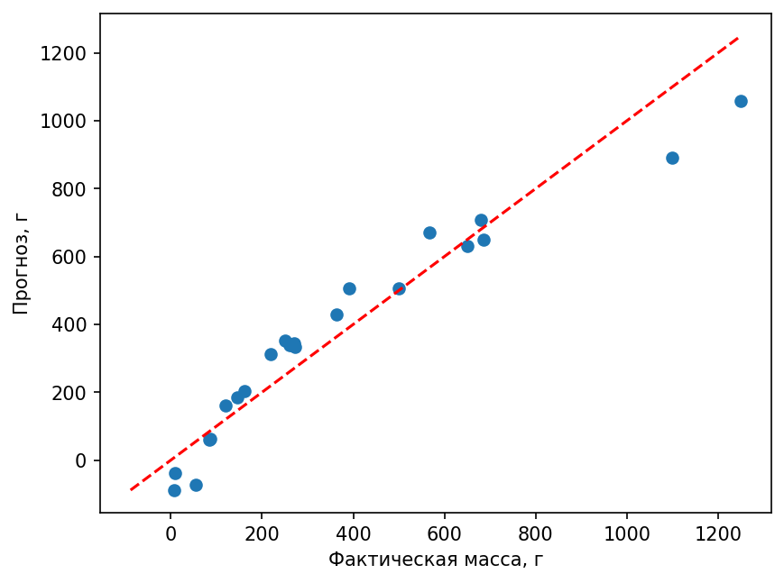
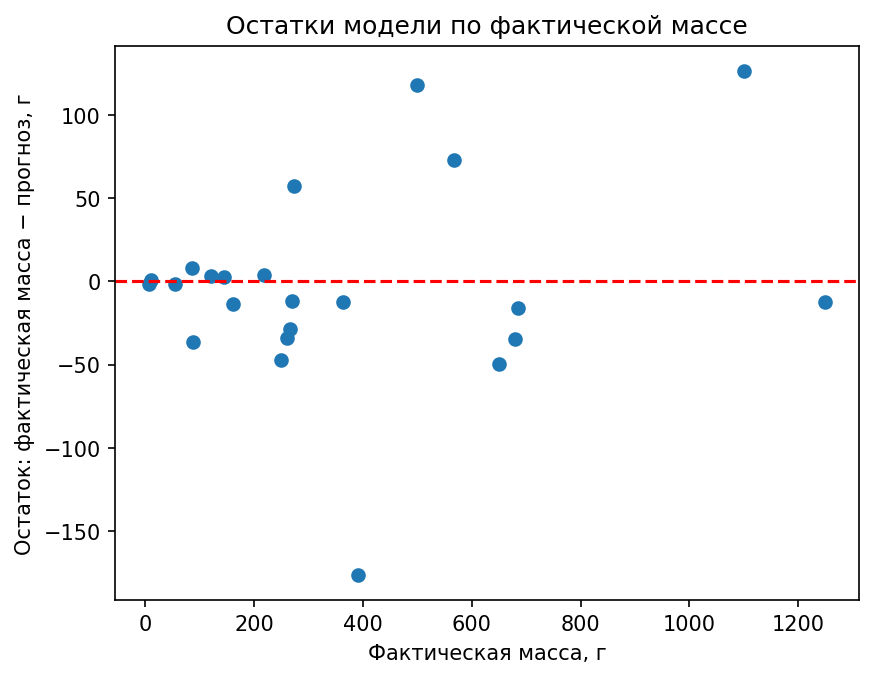
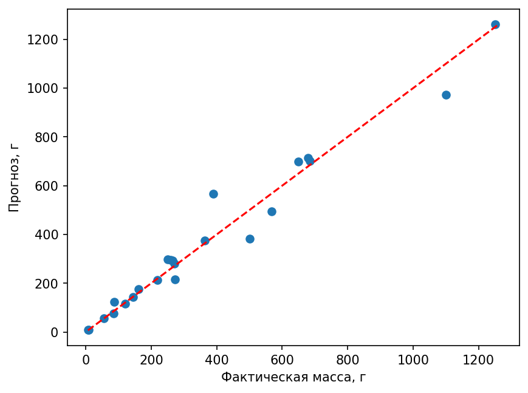
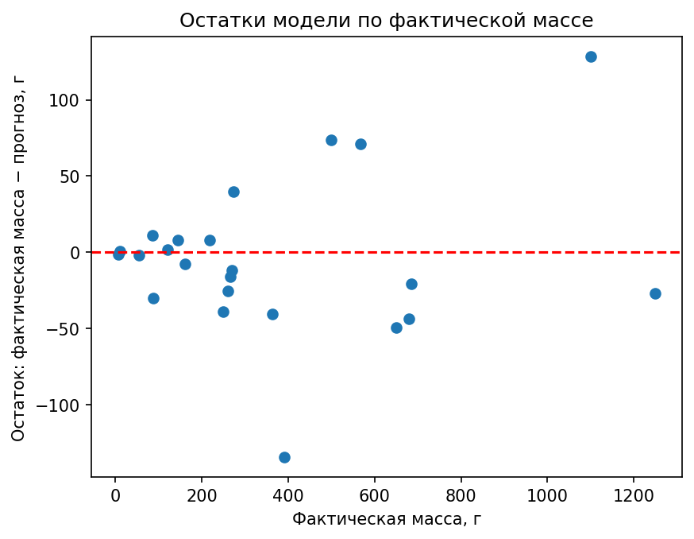
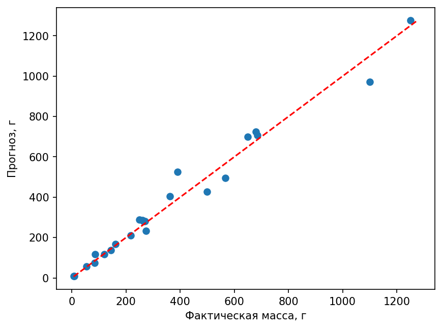

# Лабораторная работа №2: прогноз массы рыбы

## Цель

Сравнить несколько регрессионных моделей для прогноза массы рыбы `Масса` по
виду и измерениям тела, выбрать лучшую модель и проанализировать её ошибки.

## Данные и методика

- Данные: `fish_participant.csv`.
- Целевая переменная: `Масса`, граммы.
- Разделение: 79.28% для обучения и 20.72% для тестирования, начальное состояние генератора — 42.
- Базовые признаки: `Длина 3`, `Высота`, `Ширина`, `Вид рыбы`.
- Для E1–E4: числовые признаки заполняются медианой и масштабируются; вид рыбы
  кодируется отдельными индикаторами категорий с обработкой неизвестной категории.
- Метрики: средняя квадратичная ошибка (MSE) (г²), средняя абсолютная ошибка (MAE) (г), R². Для средней квадратичной и средней абсолютной ошибки меньшее значение лучше, для R²
  большее значение лучше.

## Эксперименты E0–E4

| Версия | Модель | Особенность | Средняя абсолютная ошибка на тесте (MAE), г | Средняя квадратичная ошибка на тесте (MSE), г² | Коэффициент детерминации на тесте (R²) | Средняя квадратичная ошибка кросс-валидации (MSE), г² | Некорректные прогнозы |
|---|---|---|---:|---:|---:|---:|---:|
| Э0-среднее | Константная базовая модель | Средняя масса обучающей выборки | 268.49 | 106322.94 | -0.021 | — | 0 |
| Э0-медиана | Константная базовая модель | Медиана массы обучающей выборки | 238.24 | 108359.43 | -0.040 | — | 0 |
| E1 | Линейная регрессия | Линейная связь | 74.54 | 7825.40 | 0.925 | 16459.48 ± 12953.71 | 3 отрицательных |
| E2 | Регрессия с регуляризацией | Регуляризация, коэффициент регуляризации — 1 | 73.84 | 8053.05 | 0.923 | 14460.84 ± 10007.82 | 3 отрицательных |
| E3 | Случайный лес | 300 деревьев, базовые признаки | 37.79 | 3469.70 | 0.967 | 9449.81 ± 11100.90 | 0 |
| E4-A | Случайный лес | Контрольная версия E4 | 37.79 | 3469.70 | 0.967 | 9449.81 ± 11100.90 | 0 |
| E4-B | Случайный лес + Приблизительный объём | `Приблизительный объём = Длина 3 × Высота × Ширина` | **34.37** | **2503.42** | **0.976** | **9278.21 ± 10180.41** | **0** |

## Вывод по сравнению моделей

E0 показывает, что прогноз одной константой непригоден: ошибка превышает
238 г, а R² отрицательный. Линейные модели E1 и E2 лучше базовой модели, но дают
физически невозможные отрицательные массы. Случайный лес в E3 снижает среднюю абсолютную ошибку почти
в два раза и не создаёт некорректных прогнозов.

Добавление признака «Приблизительный объём» в E4-B улучшило итоговую модель: средняя абсолютная ошибка (MAE) снизилась с 37.79 г до
34.37 г, а R² вырос с 0.967 до 0.976. Для итогового использования выбрана E4-B.

## Анализ ошибок E4-B

### График остатков

График `остатки_по_фактической_массе.png` сохранён в артефактах MLflow текущего
запуска E4-B. Он показывает разность `фактическая масса − прогноз`. Среднее смещение
в каждом из трёх диапазонов `Длина 3` не превысило общую среднюю абсолютную ошибку, то есть выраженного
одностороннего смещения не найдено.

### Ошибка по размеру

| Диапазон длины 3 | Число рыб | Средняя абсолютная ошибка (MAE), г | Средний остаток, г |
|---|---:|---:|---:|
| 10.80–27.13 | 8 | 7.74 | -2.48 |
| 27.13–34.50 | 7 | 25.73 | -12.21 |
| 34.50–59.70 | 8 | 68.57 | -0.19 |

Абсолютная ошибка заметно растёт с размером: крупные рыбы прогнозируются хуже,
хотя средний остаток в этой группе близок к нулю. Это означает большой разброс
ошибок, а не стабильную переоценку или недооценку.

### Ошибка по виду

| Вид | Число рыб | Средняя абсолютная ошибка (MAE), г | Средний остаток, г |
|---|---:|---:|---:|
| Лещ | 5 | 45.59 | -16.06 |
| Густера | 2 | 20.67 | 18.91 |
| Окунь | 8 | 29.68 | 9.51 |
| Щука | 2 | 49.03 | 22.20 |
| Плотва | 3 | 57.45 | -57.45 |
| Корюшка | 2 | 0.87 | -0.36 |
| Сиг | 1 | 11.68 | -11.68 |

Наиболее сложный вид — плотва, затем щука и лещ. Для видов с одним или двумя
тестовыми наблюдениями выводы ненадёжны: одной ошибки недостаточно для оценки
качества модели на всём виде.

### Пять крупнейших ошибок

Таблица `пять_крупнейших_ошибок.csv` сохранена в артефактах MLflow и содержит
исходные признаки каждой рыбы. Для E4-B крупнейшая ошибка — плотва: фактическая
масса 390 г, прогноз 524.49 г, абсолютная ошибка 134.49 г. Остальные четыре
наибольшие ошибки относятся к окуню (128.50 г), лещу (73.81 г), щуке (71.23 г)
и лещу (49.24 г).

### Проверка физической корректности

Для E4-B:

- отрицательных прогнозов: 0;
- неположительных прогнозов: 0;
- нечисловых прогнозов (`NaN`, `inf`): 0;
- прогнозов за пределами массы обучающей выборки [5.9; 1550.0] г: 0.

## Причина ошибок и следующий эксперимент

Основная причина ошибок — сочетание модели и данных: разные виды имеют разные
формы, а на отдельных видах и крупных рыбах мало примеров. По имеющемуся тесту
нельзя доказать, что проблема вызвана только данными или только моделью.

Следующий эксперимент: обучить отдельные модели для каждого вида и сравнить их
с общей моделью E4-B по средней абсолютной ошибке. Ожидаемый результат: ошибка снизится прежде всего
для леща, щуки и плотвы, если для этих видов достаточно обучающих наблюдений.

## Воспроизводимость

Обучение и MLflow-логирование запускаются из `src/run_mlflow.py`. Артефакты
каждого запуска включают прогнозы, графики, среднюю абсолютную ошибку по видам и размерным группам,
пять крупнейших ошибок и текстовый анализ ошибок.

## Полные результаты: данные, методика и дополнительные эксперименты

Этот раздел дополняет итоговую таблицу всеми доступными результатами скриптов, сохранённых запусков MLflow и исходного ноутбука. Повторные и архивные запуски приведены в отдельном приложении. Результаты исходного ноутбука относятся к другому разбиению и показаны отдельно.

### Данные и контроль качества

Источник `fish_participant.csv` содержит 111 строк, 7 столбцов и 7 видов. Столбцы: вид (`Species`), масса (`Weight`), три длины (`Length1`, `Length2`, `Length3`), высота (`Height`) и ширина (`Width`). Масса — в граммах, размеры — в единицах исходного набора.

Проверено по текущему файлу: пропусков — 0; повторяющихся строк — 0; неположительных масс и размеров — 0; нарушений `Length1 ≤ Length2 ≤ Length3` — 0. Исходный CSV не изменялся.

#### Описательная статистика

| Показатель | Масса | Длина 1 | Длина 2 | Длина 3 | Высота | Ширина |
|---|---|---|---|---|---|---|
| Среднее | 401.68 | 26.45 | 28.62 | 31.42 | 9.02 | 4.48 |
| Стандартное отклонение | 338.51 | 9.80 | 10.50 | 11.31 | 4.23 | 1.70 |
| Минимум | 5.90 | 7.50 | 8.40 | 8.80 | 1.74 | 1.05 |
| Первый квартиль | 142.50 | 20.00 | 22.00 | 23.50 | 6.14 | 3.55 |
| Медиана | 300.00 | 25.40 | 27.50 | 30.10 | 8.15 | 4.33 |
| Третий квартиль | 682.50 | 33.75 | 36.25 | 40.15 | 12.14 | 5.66 |
| Максимум | 1550.00 | 56.00 | 60.00 | 64.00 | 18.96 | 8.14 |

Коэффициент асимметрии массы на обучающей выборке — 0.805; распределение имеет правую асимметрию.

#### Состав по видам

| Вид | Всего | Обучение | Тест |
|---|---|---|---|
| Лещ | 24 | 19 | 5 |
| Густера | 8 | 6 | 2 |
| Окунь | 39 | 31 | 8 |
| Щука | 12 | 10 | 2 |
| Плотва | 14 | 11 | 3 |
| Корюшка | 10 | 8 | 2 |
| Сиг | 4 | 3 | 1 |

### Разбиение и предобработка

**88 строк обучения и 23 строки теста**. Индексы зафиксированы в `src/split_indices.json`. Разбиение стратифицировано по виду: `test_size=0.2`, `random_state=42`. Проверены непересечение и полное покрытие исходных строк. Групповые идентификаторы хозяйства, партии или времени отсутствуют; групповая оценка не реализована.

Числовые пропуски заполняются медианой, числа масштабируются `StandardScaler`. Пропуски вида заполняются наиболее частым видом, категория кодируется `OneHotEncoder(handle_unknown="ignore")`. Предобработка и регрессор объединены в `Pipeline` и обучаются только на обучающей части каждого фолда. Проверочный фолд и тест не участвуют в настройке медиан, масштаба и кодировщика.

Кросс-валидация: `KFold(n_splits=5, shuffle=True, random_state=42)`. Подбор использует `neg_mean_squared_error`; в отчёте знак преобразован обратно к MSE. Выбор модели — по минимальному среднему MSE кросс-валидации, а не по тесту. Среднее ± стандартное отклонение по фолдам **не является доверительным интервалом**.

### Определения метрик

- **Средняя квадратичная ошибка (MSE)**: `Σ(y − ŷ)² / n`, единицы — г²; особенно чувствительна к крупным промахам, меньше — лучше.
- **Средняя абсолютная ошибка (MAE)**: `Σ|y − ŷ| / n`, единицы — г; средняя величина промаха, меньше — лучше.
- **Коэффициент детерминации (R²)**: `1 − Σ(y − ŷ)² / Σ(y − среднее(y))²`; больше — лучше. Отрицательный R² означает результат хуже константы, равной среднему значению массы именно оцениваемой выборки.

### Мультиколлинеарность и выбор длины

| Пара признаков | Корреляция Пирсона на обучении |
|---|---|
| Length1 / Length2 | 0.9995 |
| Length1 / Length3 | 0.9912 |
| Length2 / Length3 | 0.9936 |
| Length3 / Height | 0.7000 |
| Length3 / Width | 0.8635 |
| Height / Width | 0.7809 |

Три длины почти дублируют друг друга, поэтому оставлена длина 3. Её корреляция с массой на обучении — 0.9057, наибольшая среди трёх длин. Корреляция объёма с массой — 0.9296, с длиной 3 — 0.8184, с высотой — 0.8905, с шириной — 0.8809. Производный объём связан с размерами; в Э4 он добавляется к лесу, а не к линейной модели. Корреляция и важность признака не доказывают причинного влияния.

### Конфигурации и бюджет поиска

| Версия | Область поиска | Бюджет обучений |
|---|---|---|
| Э0 | Среднее и медиана массы обучения | Две константы, без регрессора |
| Э1 | Линейная регрессия, без подбора | 5 обучений кросс-валидации + 1 итоговое |
| Э2 | `alpha ∈ [0.01, 0.1, 1, 10, 100]` | 5 кандидатов × 5 фолдов + 1 итоговое = 26 |
| Э3 | 300 деревьев; глубина `[None, 12]`; минимум в листе `[1, 2]` | 4 кандидата × 5 фолдов + 1 итоговое = 21 |
| Э4-А | Та же сетка, базовые признаки | 21 |
| Э4-Б | Та же сетка, добавлен объём | 21 |

Заданный суммарный бюджет Э1–Э4 — **95 обучений регрессоров**. Для Ridge выбран `alpha=1`; для лесов — 300 деревьев, отсутствие ограничения глубины и минимум одно наблюдение в листе. Начальное состояние генератора леса — 42.

Оценки всех кандидатов, отдельных фолдов и длительности отдельных обучений не сохранены. В журнале есть среднее и стандартное отклонение MSE выбранного кандидата; отсутствующие измерения не подменяются предположениями.

Ridge добавляет штраф за большие коэффициенты. Коэффициенты числовых признаков сопоставляются после согласованного масштабирования; индикаторы видов имеют другую интерпретацию.

### Константы Э0

| Версия | Постоянный прогноз, г | Тест MAE, г | Тест MSE, г² | Тест R² |
|---|---|---|---|---|
| Э0-среднее | 411.31 | 268.49 | 106322.94 | -0.0208 |
| Э0-медиана | 300.00 | 238.24 | 108359.43 | -0.0403 |

Добавление объёма уменьшило MAE на 3.41 г (9.03%), тестовый MSE — на 27.85%, средний MSE кросс-валидации — на 1.82%. Гипотеза подтверждена на данном разбиении; высокий разброс по фолдам не доказывает устойчивость улучшения на любых новых данных.

### MAE всех моделей по видам, г

| Вид | Число рыб | Э1 | Э2 | Э3 | Э4-А | Э4-Б |
|---|---|---|---|---|---|---|
| Лещ | 5 | 32.93 | 30.90 | 46.18 | 46.18 | 45.59 |
| Густера | 2 | 106.97 | 93.04 | 29.21 | 29.21 | 20.67 |
| Окунь | 8 | 81.43 | 82.75 | 31.82 | 31.82 | 29.68 |
| Щука | 2 | 143.91 | 148.48 | 42.41 | 42.41 | 49.03 |
| Плотва | 3 | 73.42 | 60.85 | 75.48 | 75.48 | 57.45 |
| Корюшка | 2 | 47.80 | 71.06 | 1.17 | 1.17 | 0.87 |
| Сиг | 1 | 80.59 | 74.03 | 11.55 | 11.55 | 11.68 |

### MAE всех моделей по диапазонам длины 3, г

| Диапазон | Число рыб | Э1 | Э2 | Э3 | Э4-А | Э4-Б |
|---|---|---|---|---|---|---|
| (10.799000000000001, 27.133] | 8 | 54.03 | 54.91 | 8.50 | 8.50 | 7.74 |
| (27.133, 34.5] | 7 | 85.68 | 78.60 | 27.85 | 27.85 | 25.73 |
| (34.5, 59.7] | 8 | 85.28 | 88.59 | 75.77 | 75.77 | 68.57 |

Диапазоны определены по трём квантильным группам тестовых длин только для анализа ошибок, а не для настройки модели. Рост MAE с размером указывает на неоднородность ошибок, но формальный тест гетероскедастичности не выполнен. Правило поиска систематических зон также является эвристикой, а не статистическим тестом.

### Физическая корректность всех моделей

| Версия | Отрицательные | Неположительные | NaN / бесконечность | Вне массы обучения |
|---|---|---|---|---|
| Э1 | 3 | 3 | 0 | 3 |
| Э2 | 3 | 3 | 0 | 3 |
| Э3 | 0 | 0 | 0 | 0 |
| Э4-А | 0 | 0 | 0 | 0 |
| Э4-Б | 0 | 0 | 0 | 0 |

Выход за диапазон массы обучения [5,9; 1550,0] г — сигнал экстраполяции, а не самостоятельное доказательство физической невозможности.

### Пять крупнейших ошибок каждой модели с исходными признаками

Индекс строки начинается с нуля и относится к исходному CSV. Масса и ошибка — в граммах.

#### Э1

| Строка | Вид рыбы | Длина 1 | Длина 2 | Длина 3 | Высота | Ширина | Фактическая масса | Прогноз массы | Абсолютная ошибка |
|---|---|---|---|---|---|---|---|---|---|
| 84 | Щука | 52.00 | 56.00 | 59.70 | 10.69 | 6.98 | 1250.00 | 1071.72 | 178.28 |
| 24 | Окунь | 39.00 | 42.00 | 44.60 | 12.80 | 6.87 | 1100.00 | 941.47 | 158.53 |
| 22 | Густера | 13.50 | 14.70 | 16.50 | 6.85 | 2.33 | 55.00 | -97.88 | 152.88 |
| 67 | Плотва | 29.50 | 31.70 | 35.00 | 9.48 | 5.36 | 390.00 | 522.80 | 132.80 |
| 35 | Щука | 43.20 | 46.00 | 48.70 | 7.79 | 4.87 | 567.00 | 676.53 | 109.53 |

#### Э2

| Строка | Вид рыбы | Длина 1 | Длина 2 | Длина 3 | Высота | Ширина | Фактическая масса | Прогноз массы | Абсолютная ошибка |
|---|---|---|---|---|---|---|---|---|---|
| 24 | Окунь | 39.00 | 42.00 | 44.60 | 12.80 | 6.87 | 1100.00 | 891.80 | 208.20 |
| 84 | Щука | 52.00 | 56.00 | 59.70 | 10.69 | 6.98 | 1250.00 | 1057.83 | 192.17 |
| 22 | Густера | 13.50 | 14.70 | 16.50 | 6.85 | 2.33 | 55.00 | -71.75 | 126.75 |
| 67 | Плотва | 29.50 | 31.70 | 35.00 | 9.48 | 5.36 | 390.00 | 506.16 | 116.16 |
| 35 | Щука | 43.20 | 46.00 | 48.70 | 7.79 | 4.87 | 567.00 | 671.78 | 104.78 |

#### Э3

| Строка | Вид рыбы | Длина 1 | Длина 2 | Длина 3 | Высота | Ширина | Фактическая масса | Прогноз массы | Абсолютная ошибка |
|---|---|---|---|---|---|---|---|---|---|
| 67 | Плотва | 29.50 | 31.70 | 35.00 | 9.48 | 5.36 | 390.00 | 566.40 | 176.40 |
| 24 | Окунь | 39.00 | 42.00 | 44.60 | 12.80 | 6.87 | 1100.00 | 973.43 | 126.57 |
| 17 | Лещ | 29.10 | 31.50 | 36.40 | 13.76 | 4.37 | 500.00 | 381.99 | 118.01 |
| 35 | Щука | 43.20 | 46.00 | 48.70 | 7.79 | 4.87 | 567.00 | 494.24 | 72.76 |
| 51 | Густера | 23.00 | 25.00 | 28.00 | 11.09 | 4.14 | 273.00 | 215.85 | 57.15 |

#### Э4-А

| Строка | Вид рыбы | Длина 1 | Длина 2 | Длина 3 | Высота | Ширина | Фактическая масса | Прогноз массы | Абсолютная ошибка |
|---|---|---|---|---|---|---|---|---|---|
| 67 | Плотва | 29.50 | 31.70 | 35.00 | 9.48 | 5.36 | 390.00 | 566.40 | 176.40 |
| 24 | Окунь | 39.00 | 42.00 | 44.60 | 12.80 | 6.87 | 1100.00 | 973.43 | 126.57 |
| 17 | Лещ | 29.10 | 31.50 | 36.40 | 13.76 | 4.37 | 500.00 | 381.99 | 118.01 |
| 35 | Щука | 43.20 | 46.00 | 48.70 | 7.79 | 4.87 | 567.00 | 494.24 | 72.76 |
| 51 | Густера | 23.00 | 25.00 | 28.00 | 11.09 | 4.14 | 273.00 | 215.85 | 57.15 |

#### Э4-Б

| Строка | Вид рыбы | Длина 1 | Длина 2 | Длина 3 | Высота | Ширина | Приблизительный объём | Фактическая масса | Прогноз массы | Абсолютная ошибка |
|---|---|---|---|---|---|---|---|---|---|---|
| 67 | Плотва | 29.50 | 31.70 | 35.00 | 9.48 | 5.36 | 1777.73 | 390.00 | 524.49 | 134.49 |
| 24 | Окунь | 39.00 | 42.00 | 44.60 | 12.80 | 6.87 | 3921.09 | 1100.00 | 971.50 | 128.50 |
| 17 | Лещ | 29.10 | 31.50 | 36.40 | 13.76 | 4.37 | 2187.65 | 500.00 | 426.19 | 73.81 |
| 35 | Щука | 43.20 | 46.00 | 48.70 | 7.79 | 4.87 | 1848.02 | 567.00 | 495.77 | 71.23 |
| 21 | Лещ | 31.00 | 33.50 | 38.70 | 14.47 | 5.73 | 3208.24 | 650.00 | 699.24 | 49.24 |

### Графики остатков и зависимости прогноза от массы

#### Э1





#### Э2





#### Э3





#### Э4-А


#### Э4-Б





### Результаты исходного ноутбука

В `data_analysis_and_model_selection.ipynb` сохранены анализ типов данных, пропусков, распределений, корреляций, выбросов, графики остатков, нормальных квантилей и распределения остатков.

Правило межквартильного размаха выявило строку 13: масса 1550 г, длина 1 — 56, длина 2 — 60. Она удалена до разбиения, осталось 110 рыб. Ноутбук использует `test_size=0.25`, `random_state=0`: 82 строки обучения, 28 теста. Размеры и масса логарифмируются через `log`, обратное преобразование — `exp`. В Э0–Э4 эта строка сохранена и разбиение другое.

| Модель ноутбука | Тест MSE, г² | Тест R² | Средний MSE кросс-валидации, г² |
|---|---|---|---|
| Линейная регрессия с логарифмированием | 1023,76 | 0,9821 | 2217,90 |
| Lasso с логарифмированием | 1053,33 | 0,9816 | 2204,06 |
| Случайный лес, 10 деревьев, с логарифмированием | 3010,63 | 0,9473 | 4568,82 |

Это сохранённые выходы ячеек 40, 48 и 54, а не новый запуск. MAE в них отсутствует. Для Lasso выбран `alpha=0.001` из 12 значений от `1e-15` до `40`. Внутренний подбор выполнялся в логарифмической шкале: лучшая оценка `neg_mean_squared_error = −0.0104625` не измеряется в г² и не сравнима с MSE исходной массы. Внешняя кросс-валидация использовала все 110 строк, включая строки отдельного теста; поэтому она не независима от этого теста.

В исходном подходе выбрана логарифмическая линейная модель, обучена на всех 110 строках и сохранена как `reg_notebook_model.joblib`. Скрипт `train.py` сохраняет аналогичную исходную цепочку в `reg.joblib`, которую загружает `predict_from_csv()` в `predict.py`. Этот интерфейс **не подключён к итоговой Э4-Б**.

Числа ноутбука нельзя напрямую сравнивать с Э0–Э4: различаются строки, разбиение и процедура оценивания. Вариант `log(1 + y)` с обратным `expm1` на основном разбиении не выполнен.

### Происхождение результатов MLflow

| Версия | Идентификатор запуска | Дата, UTC | Артефакты |
|---|---|---|---|
| Э1 | 733e773da1fd4dbe9803d9ccbeae0466 | 2026-10-10 13:03:13 | [Каталог](../src/mlruns/0/733e773da1fd4dbe9803d9ccbeae0466/artifacts) |
| Э2 | ed88cbb9fea14bf380f99aa4290fbfac | 2026-10-10 13:03:17 | [Каталог](../src/mlruns/0/ed88cbb9fea14bf380f99aa4290fbfac/artifacts) |
| Э3 | 1ae33889d76a431fb0d997c38d5ce2ea | 2026-10-10 13:03:30 | [Каталог](../src/mlruns/0/1ae33889d76a431fb0d997c38d5ce2ea/artifacts) |
| Э4-А | 37e80385e4174ea7bbb66ae7746f7b1c | 2026-10-10 13:03:40 | [Каталог](../src/mlruns/0/37e80385e4174ea7bbb66ae7746f7b1c/artifacts) |
| Э4-Б | 39abc73b9dfc4b39bbe8d01015b99323 | 2026-10-10 13:03:42 | [Каталог](../src/mlruns/0/39abc73b9dfc4b39bbe8d01015b99323/artifacts) |

Окружение сохранённого запуска Э4-Б: Python 3.7.17, scikit-learn 1.0.2, MLflow 1.30.1. Коммит: `3b4798cb8fc6f2077d9b5500bc97c1f1a7544c7f`.

В текущем окружении scikit-learn 0.23.2. Попытка прогнозирования старой моделью завершилась ошибкой несовместимости `ColumnTransformer`. Поэтому при подготовке отчёта **метрики MSE, MAE и R² сверены с сохранёнными CSV**, а повторное прогнозирование сохранённых моделей в текущем окружении не подтверждено. Для загрузки старых пайплайнов нужно восстановить совместимое окружение.

SHA-256 текущего набора данных: `3b9dfeca13eee107610c69243739e516f6aa0e7455ca29054b923f843a6f9d04`.

SHA-256 разбиения: `fd47c9b4778ab04a0e35016c5037e1797760504bab2df00cd2d1806734c67f92`.

Хеши рассчитаны при подготовке отчёта; в исходных запусках отдельная версия или хеш данных не записаны.

### Артефакты и воспроизведение

Сохранены параметры разбиения, начальное состояние, признаки, гиперпараметры, метрики теста и кросс-валидации, версии и коммит. `artifacts/model/` содержит пайплайн, схему, пример входа и окружение; `artifacts/анализ_ошибок/` — таблицы прогнозов, пяти ошибок, групп по виду и размеру, два графика и анализ. У выбранной модели есть `artifacts/документация/паспорт_модели.md`.

Э0 рассчитывается отдельным скриптом, но отдельные запуски Э0 в MLflow не записаны. Класс регрессора хранится в модели; отдельный параметр класса записан не одинаково для всех вариантов.

Из корня проекта, после восстановления подходящего окружения:

```bash
source .venv/bin/activate
export MLFLOW_TRACKING_URI="file://$(pwd)/src/mlruns"
python src/e0.py
python src/run_mlflow.py
bash run_mlflow_ui.sh
```

Явный путь нужен, поскольку MLflow по умолчанию пишет относительно рабочего каталога, а сценарий интерфейса использует `src/mlruns`. Разбиение уже сохранено; `python src/split_data.py` используется только для его намеренного повторного создания.

Э4-Б загружается через `mlflow.sklearn.load_model` из `artifacts/model/`. Перед прогнозом требуется вычислить `Vproxy` через `add_vproxy()`: вычисление этого столбца находится **вне сохранённого пайплайна**.

### Результаты проверок

10 октября 2026 года на заново обученном линейном пайплайне выполнены проверки тех же инвариантов, которые заданы в `tests/test_pipeline.py`:

| Проверка | Результат |
|---|---|
| Индексы обучения и теста не пересекаются; все строки покрыты | Пройдена |
| Неизвестный вид принимается; прогноз конечен | Пройдена |
| Число прогнозов равно числу входных строк; все значения конечны | Пройдена |
| Для масс `[100, 200]` и прогнозов `[110, 180]`: MAE = 15, MSE = 250 | Пройдена |
| Сохранение и загрузка новой модели воспроизводят прогноз при `rtol=atol=1e-8` | Пройдена |

Проверки выполнены прямыми утверждениями. Сам `tests/test_pipeline.py` через pytest не запускался: pytest отсутствует в проектном окружении.

Команда `PYTHONDONTWRITEBYTECODE=1 .venv/bin/python -m unittest discover -s tests -p test_mlflow_reports.py -v` завершилась успешно: **3 теста пройдены**. Проверены допустимость названий MLflow, русский отчёт и паспорт, сохранение и загрузка новой модели, совпадение прогнозов и сохранность входных данных при экспорте. Это не подтверждает совместимость старых моделей другого окружения.

Полный подбор гиперпараметров и весь ноутбук при подготовке отчёта не повторялись. Кросс-валидация взята из журнала; тестовые метрики дополнительно сверены с сохранёнными таблицами.

### Паспорт прототипа и ограничения

Итоговый регрессор — случайный лес с 300 деревьями, без ограничения глубины, минимум одним наблюдением в листе и начальным состоянием 42. Вход: длина 3, высота, ширина, вид, вычисленный объём. Предобработка и регрессор сохранены вместе; вычисление объёма — отдельно. Подробные паспорта: [model-passports.md](model-passports.md).

Ограничения: небольшой тест, мало редких видов, большая ошибка крупных рыб, нестабильность фолдов. Неизвестный вид технически принимается, но качество на таких видах не измерено. Не проверены новые хозяйства, партии, сезоны и приборы. Доверительные интервалы и интервалы прогноза не рассчитаны.

### Что ещё не подтверждено по методичке

- Вариант `log(1 + y)` не проверен на основном разбиении.
- Версия данных не записана отдельным полем исходных запусков.
- Исходный интерфейс прогнозирования не переключён на Э4-Б.
- Вместо отдельных `src/train.py`, `src/evaluate.py` используются `src/e0.py`–`src/e4.py` и `src/run_mlflow.py`.
- `models/model-card.md` отсутствует; паспорта находятся в `reports/model-passports.md` и MLflow.
- pytest-набор не запускался; обязательные инварианты проверены отдельно.
- Сохранённым старым моделям требуется совместимое окружение.
- Дополнительная часть с интервалами или Docker-сценарием не выполнена.
- Приёмка, защита, рецензирование, запрос на слияние и тег `v0.1` этим отчётом не подтверждаются.

Отдельные модели по видам остаются предложенным следующим экспериментом; результатов такого обучения нет.

## Приложение А. Все прогнозы на фиксированном тесте

Все 23 наблюдения; масса и прогнозы — в граммах.

| Строка | Вид | Фактическая масса | Прогноз Э1 | Прогноз Э2 | Прогноз Э3 | Прогноз Э4-А | Прогноз Э4-Б |
|---|---|---|---|---|---|---|---|
| 74 | Окунь | 260.00 | 354.17 | 340.14 | 294.18 | 294.18 | 285.25 |
| 57 | Окунь | 218.00 | 325.83 | 311.44 | 214.31 | 214.31 | 210.27 |
| 25 | Плотва | 87.00 | 55.83 | 62.35 | 123.30 | 123.30 | 116.98 |
| 8 | Корюшка | 6.70 | -67.43 | -88.44 | 8.09 | 8.09 | 7.93 |
| 95 | Корюшка | 9.80 | -11.68 | -37.18 | 8.85 | 8.85 | 9.29 |
| 84 | Щука | 1250.00 | 1071.72 | 1057.83 | 1262.07 | 1262.07 | 1276.83 |
| 22 | Густера | 55.00 | -97.88 | -71.75 | 56.27 | 56.27 | 56.76 |
| 77 | Лещ | 680.00 | 696.23 | 707.61 | 714.33 | 714.33 | 723.60 |
| 20 | Окунь | 85.00 | 70.01 | 60.70 | 76.65 | 76.65 | 74.19 |
| 97 | Плотва | 161.00 | 217.29 | 202.74 | 174.74 | 174.74 | 168.87 |
| 40 | Окунь | 265.00 | 352.19 | 338.32 | 293.84 | 293.84 | 281.35 |
| 7 | Окунь | 250.00 | 357.40 | 352.91 | 296.98 | 296.98 | 289.09 |
| 72 | Окунь | 120.00 | 159.56 | 159.76 | 116.52 | 116.52 | 118.15 |
| 24 | Окунь | 1100.00 | 941.47 | 891.80 | 973.43 | 973.43 | 971.50 |
| 21 | Лещ | 650.00 | 619.25 | 631.35 | 699.84 | 699.84 | 699.24 |
| 17 | Лещ | 500.00 | 529.83 | 505.47 | 381.99 | 381.99 | 426.19 |
| 76 | Сиг | 270.00 | 350.59 | 344.03 | 281.55 | 281.55 | 281.68 |
| 47 | Лещ | 685.00 | 658.68 | 649.29 | 701.17 | 701.17 | 705.88 |
| 39 | Лещ | 363.00 | 424.52 | 430.05 | 375.55 | 375.55 | 403.41 |
| 51 | Густера | 273.00 | 334.07 | 332.33 | 215.85 | 215.85 | 233.42 |
| 38 | Окунь | 145.00 | 186.77 | 184.95 | 142.52 | 142.52 | 137.13 |
| 67 | Плотва | 390.00 | 522.80 | 506.16 | 566.40 | 566.40 | 524.49 |
| 35 | Щука | 567.00 | 676.53 | 671.78 | 494.24 | 494.24 | 495.77 |

## Приложение Б. Полные таблицы признаков и ошибок

### Э1

- [Все признаки, прогнозы и остатки](../src/mlruns/0/733e773da1fd4dbe9803d9ccbeae0466/artifacts/анализ_ошибок/прогнозы_на_тесте.csv)
- [Пять крупнейших ошибок](../src/mlruns/0/733e773da1fd4dbe9803d9ccbeae0466/artifacts/анализ_ошибок/пять_крупнейших_ошибок.csv)
- [MAE и остаток по видам](../src/mlruns/0/733e773da1fd4dbe9803d9ccbeae0466/artifacts/анализ_ошибок/ошибка_по_видам.csv)
- [MAE и остаток по размерам](../src/mlruns/0/733e773da1fd4dbe9803d9ccbeae0466/artifacts/анализ_ошибок/ошибка_по_размеру.csv)
- [Сохранённый анализ ошибок](../src/mlruns/0/733e773da1fd4dbe9803d9ccbeae0466/artifacts/анализ_ошибок/анализ_ошибок.md)

### Э2

- [Все признаки, прогнозы и остатки](../src/mlruns/0/ed88cbb9fea14bf380f99aa4290fbfac/artifacts/анализ_ошибок/прогнозы_на_тесте.csv)
- [Пять крупнейших ошибок](../src/mlruns/0/ed88cbb9fea14bf380f99aa4290fbfac/artifacts/анализ_ошибок/пять_крупнейших_ошибок.csv)
- [MAE и остаток по видам](../src/mlruns/0/ed88cbb9fea14bf380f99aa4290fbfac/artifacts/анализ_ошибок/ошибка_по_видам.csv)
- [MAE и остаток по размерам](../src/mlruns/0/ed88cbb9fea14bf380f99aa4290fbfac/artifacts/анализ_ошибок/ошибка_по_размеру.csv)
- [Сохранённый анализ ошибок](../src/mlruns/0/ed88cbb9fea14bf380f99aa4290fbfac/artifacts/анализ_ошибок/анализ_ошибок.md)

### Э3

- [Все признаки, прогнозы и остатки](../src/mlruns/0/1ae33889d76a431fb0d997c38d5ce2ea/artifacts/анализ_ошибок/прогнозы_на_тесте.csv)
- [Пять крупнейших ошибок](../src/mlruns/0/1ae33889d76a431fb0d997c38d5ce2ea/artifacts/анализ_ошибок/пять_крупнейших_ошибок.csv)
- [MAE и остаток по видам](../src/mlruns/0/1ae33889d76a431fb0d997c38d5ce2ea/artifacts/анализ_ошибок/ошибка_по_видам.csv)
- [MAE и остаток по размерам](../src/mlruns/0/1ae33889d76a431fb0d997c38d5ce2ea/artifacts/анализ_ошибок/ошибка_по_размеру.csv)
- [Сохранённый анализ ошибок](../src/mlruns/0/1ae33889d76a431fb0d997c38d5ce2ea/artifacts/анализ_ошибок/анализ_ошибок.md)

### Э4-А

- [Все признаки, прогнозы и остатки](../src/mlruns/0/37e80385e4174ea7bbb66ae7746f7b1c/artifacts/анализ_ошибок/прогнозы_на_тесте.csv)
- [Пять крупнейших ошибок](../src/mlruns/0/37e80385e4174ea7bbb66ae7746f7b1c/artifacts/анализ_ошибок/пять_крупнейших_ошибок.csv)
- [MAE и остаток по видам](../src/mlruns/0/37e80385e4174ea7bbb66ae7746f7b1c/artifacts/анализ_ошибок/ошибка_по_видам.csv)
- [MAE и остаток по размерам](../src/mlruns/0/37e80385e4174ea7bbb66ae7746f7b1c/artifacts/анализ_ошибок/ошибка_по_размеру.csv)
- [Сохранённый анализ ошибок](../src/mlruns/0/37e80385e4174ea7bbb66ae7746f7b1c/artifacts/анализ_ошибок/анализ_ошибок.md)

### Э4-Б

- [Все признаки, прогнозы и остатки](../src/mlruns/0/39abc73b9dfc4b39bbe8d01015b99323/artifacts/анализ_ошибок/прогнозы_на_тесте.csv)
- [Пять крупнейших ошибок](../src/mlruns/0/39abc73b9dfc4b39bbe8d01015b99323/artifacts/анализ_ошибок/пять_крупнейших_ошибок.csv)
- [MAE и остаток по видам](../src/mlruns/0/39abc73b9dfc4b39bbe8d01015b99323/artifacts/анализ_ошибок/ошибка_по_видам.csv)
- [MAE и остаток по размерам](../src/mlruns/0/39abc73b9dfc4b39bbe8d01015b99323/artifacts/анализ_ошибок/ошибка_по_размеру.csv)
- [Сохранённый анализ ошибок](../src/mlruns/0/39abc73b9dfc4b39bbe8d01015b99323/artifacts/анализ_ошибок/анализ_ошибок.md)

[Паспорт итоговой модели в MLflow](../src/mlruns/0/39abc73b9dfc4b39bbe8d01015b99323/artifacts/документация/паспорт_модели.md)

## Приложение В. Все сохранённые запуски MLflow

Включены повторы, архивные и незавершённые запуски. Они не являются независимыми экспериментами. «—» означает отсутствие сохранённой метрики.

| Запуск | Идентификатор | Статус | Состояние | Тест MSE | Тест MAE | Тест R² |
|---|---|---|---|---|---|---|
| Э4-Б - Случайный лес с приблизительным объёмом-05668190 | 39abc73b9dfc4b39bbe8d01015b99323 | Завершён | Активный | 2503.42 | 34.37 | 0.9760 |
| Э4-А - Случайный лес с базовыми признаками-347ab3a1 | 37e80385e4174ea7bbb66ae7746f7b1c | Завершён | Активный | 3469.70 | 37.79 | 0.9667 |
| Э3 - Случайный лес-e4e48e4a | 1ae33889d76a431fb0d997c38d5ce2ea | Завершён | Активный | 3469.70 | 37.79 | 0.9667 |
| Э2 - Регрессия с регуляризацией-9b837550 | ed88cbb9fea14bf380f99aa4290fbfac | Завершён | Активный | 8053.05 | 73.84 | 0.9227 |
| Э1 - Линейная регрессия-397408f4 | 733e773da1fd4dbe9803d9ccbeae0466 | Завершён | Активный | 7825.40 | 74.54 | 0.9249 |
| Э4-Б - Случайный лес с приблизительным объёмом-1d7f82e7 | a1a4127b823247a78491ff5d2c675cde | Завершён | Активный | 2503.42 | 34.37 | 0.9760 |
| Э4-А - Случайный лес с базовыми признаками-542c3c7c | b762cd853f394fb397c0dfb3731d9234 | Завершён | Активный | 3469.70 | 37.79 | 0.9667 |
| Э3 - Случайный лес-a0ad8a92 | 8d695c79acbf43c794247fa1b947cf75 | Завершён | Активный | 3469.70 | 37.79 | 0.9667 |
| Э2 - Регрессия с регуляризацией-f9fb8140 | 4cd55f35eb5c4ac3b3869a131d9577b5 | Завершён | Активный | 8053.05 | 73.84 | 0.9227 |
| Э1 - Линейная регрессия-e0049b8c | 2a54cbd44e5e415ba8af0a1b0342f7fd | Завершён | Активный | 7825.40 | 74.54 | 0.9249 |
| Э4-Б - Случайный лес с приблизительным объёмом-4c7b07e3 | 8f14552173b44025adac711df42c70fc | Завершён | Активный | 2503.42 | 34.37 | 0.9760 |
| Э4-А - Случайный лес с базовыми признаками-53743fd3 | 761095ab05764027984541f354c62478 | Завершён | Активный | 3469.70 | 37.79 | 0.9667 |
| Э3 - Случайный лес-68ac6616 | 64608e0e441d4a79a3838554838ba721 | Завершён | Активный | 3469.70 | 37.79 | 0.9667 |
| Э2 - Регрессия с регуляризацией-b781cb91 | 019ee55cebb04253b9b9507316f76098 | Завершён | Активный | 8053.05 | 73.84 | 0.9227 |
| Э1 - Линейная регрессия-df18395e | 6257fc22baa04a03ae244a40ddf0832b | Завершён | Активный | 7825.40 | 74.54 | 0.9249 |
| Э4-Б - Случайный лес с приблизительным объёмом-b504e630 | 8a4a3ad116e042a8adb8b6e93fd0b7c3 | Завершён | Архивный | 2503.42 | 34.37 | 0.9760 |
| Э4-А - Случайный лес с базовыми признаками-fcb66ae8 | 33cad7acc0fc4cb3ab24a2da5deab0a9 | Завершён | Архивный | 3469.70 | 37.79 | 0.9667 |
| Э3 - Случайный лес-b0e1964f | 18b3fb23b4ab401299d5f25cd465b8f9 | Завершён | Архивный | 3469.70 | 37.79 | 0.9667 |
| Э2 - Регрессия с регуляризацией-b325eb24 | 600724dd4ae64d11925956c6b858c6a8 | Завершён | Архивный | 8053.05 | 73.84 | 0.9227 |
| Э1 - Линейная регрессия-f08ab91c | 1dafe5bc48254ea690a7aa64e9600da3 | Завершён | Архивный | 7825.40 | 74.54 | 0.9249 |
| Э4-Б - Случайный лес с приблизительным объёмом-dbc7c186 | bbd04257b23247fe9594c0f93e13307a | Завершён | Архивный | 2503.42 | 34.37 | 0.9760 |
| Э4-А - Случайный лес с базовыми признаками-c73dae44 | a2d77e5b2da7439c8e8f22a26c2d008b | Завершён | Архивный | 3469.70 | 37.79 | 0.9667 |
| Э3 - Случайный лес-97776f2d | 0915e977a05d4996b3c75f26097984a3 | Завершён | Архивный | 3469.70 | 37.79 | 0.9667 |
| Э2 - Регрессия с регуляризацией-de5090fa | 295d8cab31b34edc9d256164ae2c0989 | Завершён | Архивный | 8053.05 | 73.84 | 0.9227 |
| Э1 - Линейная регрессия-acde111e | c97069d17f584a07862f565384b8b272 | Завершён | Архивный | 7825.40 | 74.54 | 0.9249 |
| Э4-Б - Случайный лес с приблизительным объёмом-bbaaf54a | e7cdcbc2af7e4db7b4ac6ceab87a7849 | Завершён | Архивный | 2503.42 | 34.37 | 0.9760 |
| Э4-А - Случайный лес с базовыми признаками-6600098c | f1126c5e5aef42198176cfa42495f89d | Завершён | Архивный | 3469.70 | 37.79 | 0.9667 |
| Э3 - Случайный лес-9ea57414 | 411bb9a221b74e539a2c146848049096 | Завершён | Архивный | 3469.70 | 37.79 | 0.9667 |
| Э2 - Регрессия с регуляризацией-719b7914 | 0afb33b8b1804f6195da5bea18bda1c3 | Завершён | Архивный | 8053.05 | 73.84 | 0.9227 |
| Э1 - Линейная регрессия-d3351133 | 4b8ebbab416d47218b5a93312b9275fd | Завершён | Архивный | 7825.40 | 74.54 | 0.9249 |
| Э4-Б - Случайный лес с приблизительным объёмом-d8033e51 | 4a680ce1cd9e4928a885fdd01254491a | Завершён | Архивный | 2503.42 | 34.37 | 0.9760 |
| Э4-А - Случайный лес с базовыми признаками-3d9668fc | 22f17666e5ee4553a1eec243ef18dd3d | Завершён | Архивный | 3469.70 | 37.79 | 0.9667 |
| Э3 - Случайный лес-99cfddb6 | 3d0ff5ecc0744531836c40f71732db34 | Завершён | Архивный | 3469.70 | 37.79 | 0.9667 |
| Э2 - Регрессия с регуляризацией-fcad4814 | ba99d0fada854947a004738a3a9b2811 | Завершён | Архивный | 8053.05 | 73.84 | 0.9227 |
| Э1 - Линейная регрессия-4a14be39 | 6a933869c9d04d2997b7248eb018d0c1 | Завершён | Архивный | 7825.40 | 74.54 | 0.9249 |
| Э1 - Линейная регрессия-18196471 | 70b85b8a28094533aacec1b6e5e42862 | Ошибка | Архивный | — | — | — |
| Э1 - Линейная регрессия-01a36a0e | 5b070c18077c4195acb1736c175ac22b | Ошибка | Архивный | — | — | — |
| Э4-Б - Случайный лес с приблизительным объёмом-26604243 | bbf4f35948f441d8932b57a9e5e3a33a | Завершён | Архивный | 2503.42 | 34.37 | 0.9760 |
| Э4-А - Случайный лес с базовыми признаками-a9057eb2 | 0ab263ec031d44b4aaabb6555138e5e4 | Завершён | Архивный | 3469.70 | 37.79 | 0.9667 |
| Э3 - Случайный лес-f45b2377 | a42867fb393248118c840a0d0d9e1309 | Завершён | Архивный | 3469.70 | 37.79 | 0.9667 |
| Э2 - Регрессия с регуляризацией-3a76f876 | df885542efd9465b88aa7e99dae1856e | Завершён | Архивный | 8053.05 | 73.84 | 0.9227 |
| Э1 - Линейная регрессия-b506c920 | 403cfa9839894a6d9159d658e2075f59 | Завершён | Архивный | 7825.40 | 74.54 | 0.9249 |
| Э4-Б - Случайный лес с приблизительным объёмом-ea03a85b | 260353a38623471686f23d2cf71452fc | Завершён | Архивный | 2503.42 | 34.37 | 0.9760 |
| Э4-А - Случайный лес с базовыми признаками-17f5298c | 74f7593135b74d2595795c274acc3d5b | Завершён | Архивный | 3469.70 | 37.79 | 0.9667 |
| Э3 - Случайный лес-bf241447 | 15398f85fbb34149ba2cd0a07c325eb4 | Завершён | Архивный | 3469.70 | 37.79 | 0.9667 |
| Э2 - Регрессия с регуляризацией-9962a057 | 17900a034bdb4ca08383af9f711ac923 | Завершён | Архивный | 8053.05 | 73.84 | 0.9227 |
| Э1 - Линейная регрессия-5075bdc2 | 70225ae708ed4f3a8f2c290cf6376b1e | Завершён | Архивный | 7825.40 | 74.54 | 0.9249 |
| Э4-Б - Случайный лес с приблизительным объёмом-d4fc356d | 75670c5c83aa454db48947e330eafc99 | Завершён | Архивный | 2503.42 | 34.37 | 0.9760 |
| Э4-А - Случайный лес с базовыми признаками-f93bdcba | 2f61f59afb214be398495e2b9af782ac | Завершён | Архивный | 3469.70 | 37.79 | 0.9667 |
| Э3 - Случайный лес-c2a65efe | 00bce4736e464069ac580c2bc91742c7 | Завершён | Архивный | 3469.70 | 37.79 | 0.9667 |
| Э2 - Регрессия с регуляризацией-4f59d9ad | b276258db09b4959be6b916cd39265a6 | Завершён | Архивный | 8053.05 | 73.84 | 0.9227 |
| Э1 - Линейная регрессия-34c618e8 | 7c14ab10da3547d3bca4bd8a1b427297 | Завершён | Архивный | 7825.40 | 74.54 | 0.9249 |
| Э4-Б - Случайный лес с приблизительным объёмом-d1a0492f | fee9d6fb80954fda8f36f3776e156b6a | Завершён | Архивный | 2503.42 | 34.37 | 0.9760 |
| Э4-А - Случайный лес с базовыми признаками-91e7bc09 | fdf5a7958e824725b720c4531b2dfe3f | Завершён | Архивный | 3469.70 | 37.79 | 0.9667 |
| Э3 - Случайный лес-340377d3 | 7ee369e7dc2f40e1bca7008470dc1dc9 | Завершён | Архивный | 3469.70 | 37.79 | 0.9667 |
| Э2 - Регрессия с регуляризацией-884e9e16 | f3f7805fb7d84019bd35adf7fee7be88 | Завершён | Архивный | 8053.05 | 73.84 | 0.9227 |
| Э1 - Линейная регрессия-3c704b28 | f25dc960bb9a4258b8b0f7592cf8c9bf | Завершён | Архивный | 7825.40 | 74.54 | 0.9249 |
| Э1 - Линейная регрессия | 56b7fee8364d4d1e915a03f4485a35fb | Завершён | Архивный | 7825.40 | 74.54 | 0.9249 |
