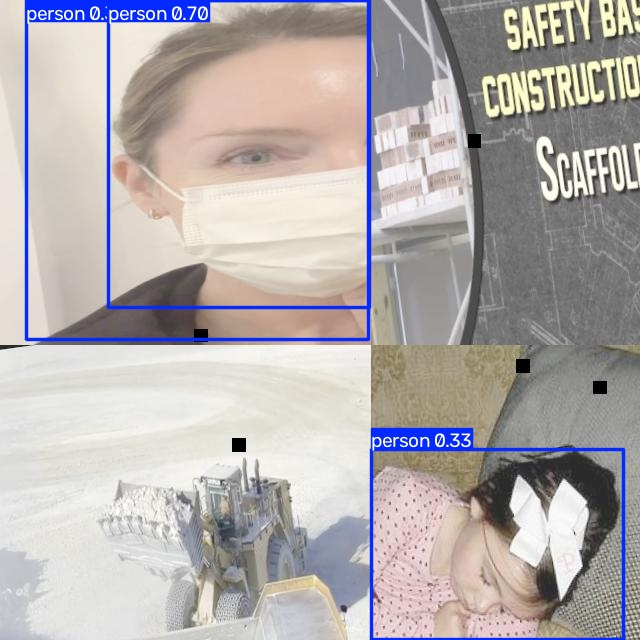
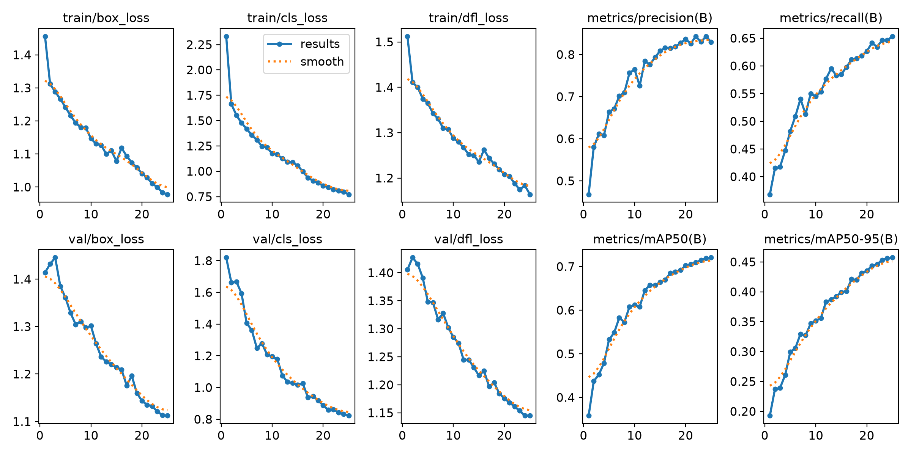
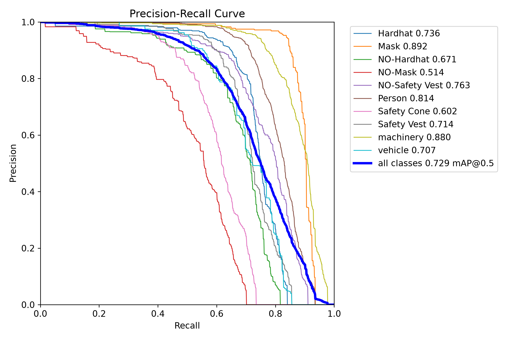
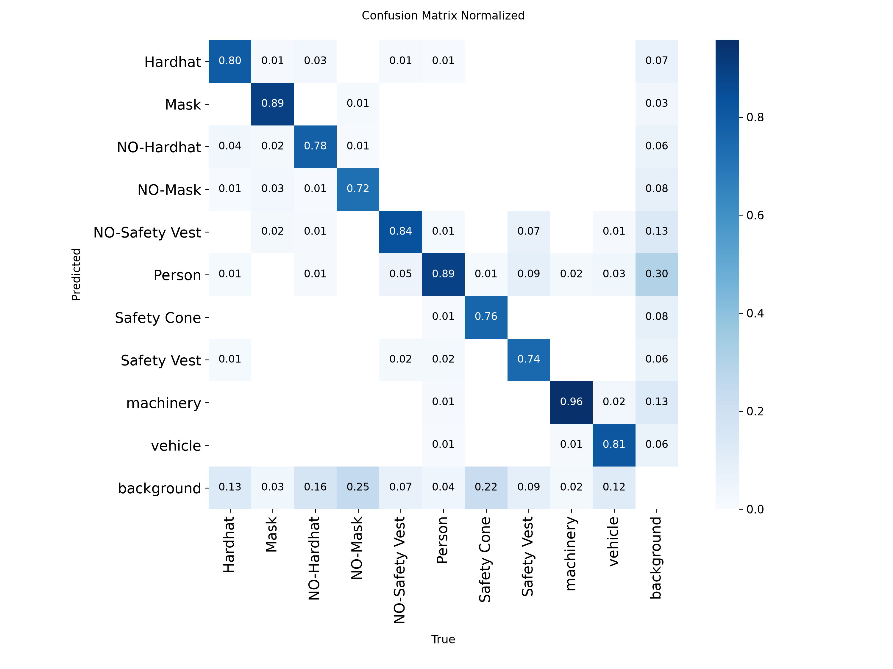
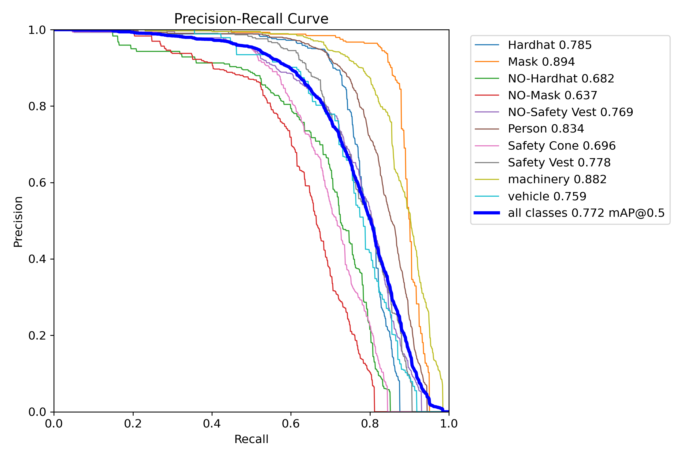
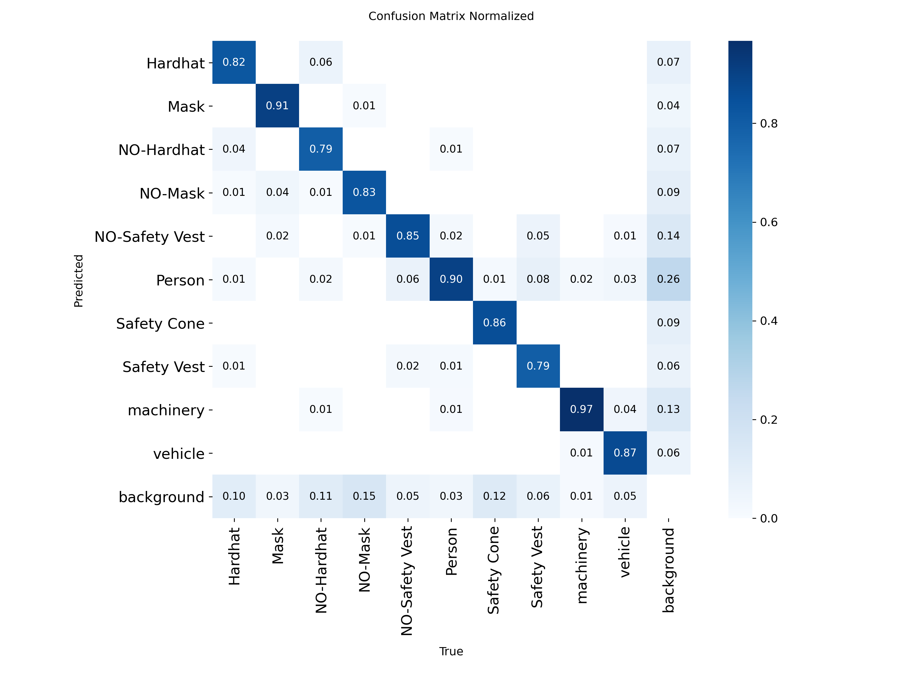
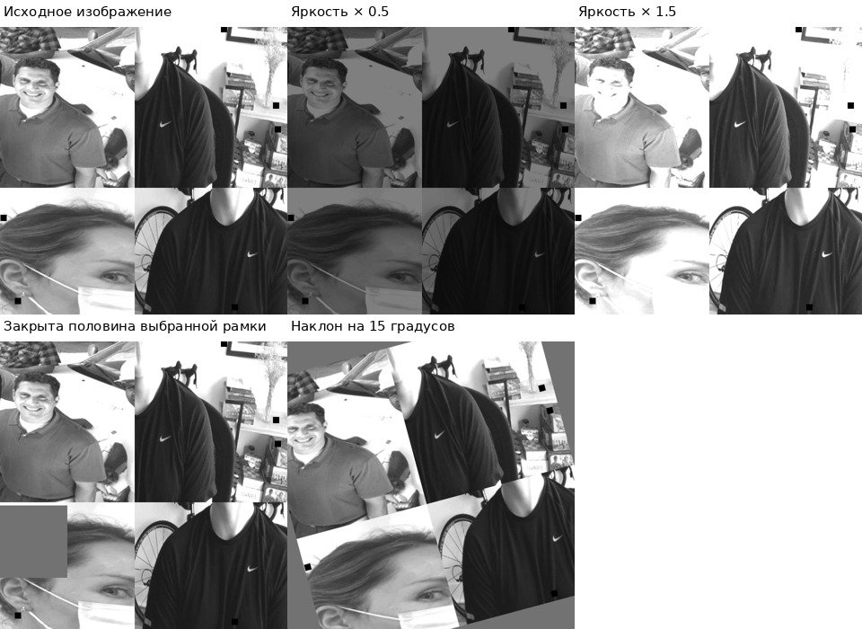

# Лабораторная работа №3: обнаружение СИЗ с YOLOv8

Дата начала: 2026-10-28. Ветка: `lab/03-ppe`. Среда подготовки данных: Python 3.12.3, Pillow 10.2.0.

## Оглавление

- [Выполненные шаги](#выполненные-шаги)
- [Данные и ручная проверка](#данные-и-ручная-проверка)
- [Разбиение](#разбиение)
- [E0. Проверка предобученной модели](#e0-проверка-предобученной-модели)
  - [Сохранённые предсказания](#сохранённые-предсказания)
  - [Различия исходного и целевого доменов](#различия-исходного-и-целевого-доменов)
  - [Наблюдения по сохранённым изображениям](#наблюдения-по-сохранённым-изображениям)
- [E1. Базовое дообучение YOLOv8n](#e1-базовое-дообучение-yolov8n)
  - [Конфигурация и длительность](#конфигурация-и-длительность)
  - [Общие метрики](#общие-метрики)
  - [AP по классам на тесте](#ap-по-классам-на-тесте)
  - [Матрица ошибок и порог уверенности](#матрица-ошибок-и-порог-уверенности)
- [E2. Увеличение разрешения до 960](#e2-увеличение-разрешения-до-960)
  - [Конфигурация и длительность E2](#конфигурация-и-длительность-e2)
  - [Общие метрики и сравнение с E1](#общие-метрики-и-сравнение-с-e1)
  - [AP по классам на тесте E2](#ap-по-классам-на-тесте-e2)
  - [Матрица ошибок и порог уверенности E2](#матрица-ошибок-и-порог-уверенности-e2)
- [6. Визуализация ошибок](#6-визуализация-ошибок)
  - [Протокол и воспроизведение](#протокол-и-воспроизведение)
  - [Шесть отдельных галерей](#шесть-отдельных-галерей)
  - [Разбор пятнадцати примеров](#разбор-пятнадцати-примеров)
  - [Распределение причин и вывод](#распределение-причин-и-вывод)
- [7. Системная оценка](#7-системная-оценка)
  - [Условия измерений](#условия-измерений)
  - [Задержка по этапам](#задержка-по-этапам)
  - [Пропускная способность и память](#пропускная-способность-и-память)
  - [Ложные тревоги](#ложные-тревоги)
  - [Устойчивость к освещению, наклону и перекрытию](#устойчивость-к-освещению-наклону-и-перекрытию)
  - [Отказ от автоматического решения и передача оператору](#отказ-от-автоматического-решения-и-передача-оператору)
  - [Контроль сдвига и откат версии](#контроль-сдвига-и-откат-версии)
- [8. Минимальные тесты](#8-минимальные-тесты)
  - [Запуск и результаты](#запуск-и-результаты)
  - [Полный набор тестов](#полный-набор-тестов)
- [Воспроизведение](#воспроизведение)
- [Следующие шаги](#следующие-шаги)

## Выполненные шаги

| Шаг | Результат |
| --- | --- |
| 2. Данные и разметка | Получен набор Roboflow Construction Site Safety v28 через Kaggle v3; 2801 изображение, 10 классов. Источник, лицензия и правила разметки описаны в [паспорте данных](../Construction-Site-Safety-PPE-Detection-main/data/README.md). |
| 2.1. Проверка разметки | Просмотрены 30 случайных кадров и 10 дополнительных с малыми объектами. Замечания по каждому кадру записаны в [журнале проверки](../Construction-Site-Safety-PPE-Detection-main/data/audit.csv); контактные листы — в [папке предпросмотра](../Construction-Site-Safety-PPE-Detection-main/data/audit_preview/). |
| 3. Разбиение без утечки | Созданы группы по имени первичного файла/ролика, сформировано новое разбиение 1961/420/420, тестовый список закреплён до экспериментов. Проверены пути, разметка, классы, имена, SHA-256, группы и визуально близкие кадры. |
| 4.1. E0 | Проверена предобученная YOLOv8n без дообучения на 10 валидационных изображениях; сохранены изображения, рамки и уверенность. Описаны различия COCO и целевого набора СИЗ. |
| 4.2. E1 | Завершено 25 эпох YOLOv8n, `imgsz=640`, `batch=16`, `seed=42`; на тесте mAP@0.5 = 0.72932 и mAP@0.5:0.95 = 0.46588. Параметры, графики и ограничения приведены в разделе E1. |
| 4.3. E2 | Завершено 25 эпох YOLOv8n в Colab, `imgsz=960`, `batch=16`, `seed=42`; на тесте mAP@0.5 = 0.77158 и mAP@0.5:0.95 = 0.49451. Сохранены веса, графики и матрицы ошибок; сравнение с E1 из Colab приведено в разделе E2. |
| 6. Визуализация ошибок | Применены лучшие веса E2 к 420 тестовым кадрам на RX 6600; программа формирует шесть галерей, сохранены 22 изображения на 20 разных кадрах. В отчёте разобраны 15 кадров и причины ошибок, включая порог и NMS. |
| 7. Системная оценка | Выполнены замеры E1/E2 на RX 6600: медиана полной задержки 13.20/19.84 мс, пропускная способность 74.99/51.69 кадров/с. Измерены память, ложные тревоги и устойчивость; описаны передача оператору и откат. |
| 8. Минимальные тесты | Пять проверок на pytest пройдены: данные из YAML, разметка, изоляция частей, размер визуализации и реальное предсказание E2. Полный набор: 14 passed; локальные E1/E2 используют одинаковый обучающий пакет 16. |

## Данные и ручная проверка

Источник: [Roboflow Universe Projects, версия 28](https://universe.roboflow.com/roboflow-universe-projects/construction-site-safety/dataset/28), копия [Snehil Sanyal на Kaggle, версия 3](https://www.kaggle.com/datasets/snehilsanyal/construction-site-safety-image-dataset-roboflow). Заявленная лицензия — CC BY 4.0; дата получения — 2026-10-28. Архив: SHA-256 `f1acf02c7116a09cdbb2b3ace1ee9b597977c0eb0bd0025e8949f81091fb2a3d`.

Изображения имеют размер 640×640. Все 2801 пары «изображение — `.txt`» читаются. В 24 файлах разметка пустая. У непустых строк правильный формат YOLO, номера классов 0–9 и нормированные координаты. Классы `NO-Hardhat`, `NO-Mask` и `NO-Safety Vest` представлены отдельными рамками области головы, лица и торса, а не отсутствием положительной рамки.

Ручная выборка воспроизводится начальным значением генератора 42. Проверялись пропуски и лишние рамки, класс, точность границ, обрезка, перекрытие, дубликаты и несовместимость источников. Часты составные кадры, сильное изменение освещения и сцены вне стройплощадки. Двадцать кадров помечены для повторной проверки в редакторе: маленькие или тёмные объекты нельзя уверенно исправить по доступным пикселям. Исходные рамки не менялись без уверенности.

## Разбиение

Исходное разбиение поставщика: 2605/114/82. В нём 21 предварительная группа пересекала две или три части. Для нового разбиения варианты одного исходного имени и кадры с общим именем ролика объединены; 716 файлов `youtube-*` без идентификатора ролика оставлены одной группой в обучении. Всего 395 групп. Применён детерминированный поиск разбиения с начальным значением 42: приоритет — целостность группы и баланс числа объектов по классам.

| Класс | Обучение | Проверка | Тест |
| --- | ---: | ---: | ---: |
| Каска | 2305 | 515 | 514 |
| Маска | 1172 | 263 | 265 |
| Без каски | 1686 | 377 | 364 |
| Без маски | 2277 | 497 | 476 |
| Без сигнального жилета | 2884 | 637 | 637 |
| Человек | 6909 | 1510 | 1453 |
| Сигнальный конус | 2376 | 524 | 602 |
| Сигнальный жилет | 2226 | 459 | 450 |
| Рабочая техника | 3740 | 817 | 789 |
| Транспорт | 1160 | 260 | 208 |
| **Изображений** | **1961** | **420** | **420** |
| **Групп** | **252** | **69** | **74** |

Списки и назначение файлов: [списки частей](../Construction-Site-Safety-PPE-Detection-main/data/splits/) и [манифест разбиения](../Construction-Site-Safety-PPE-Detection-main/data/split_manifest.csv). Тестовый список заморожен; его SHA-256: `5cabc10fa036fbda26aebce5a7b382479c30b925df6493c64b239ffb3329befe`. [Конфигурация обучения](../configs/ppe.yaml) содержит пути и имена классов.

Проверка `python3 scripts/validate_ppe_split.py --check-near-duplicates` прошла: ноль пересечений имён, SHA-256 и идентификаторов групп; все изображения и метки доступны; каждый класс есть в каждой части. Между частями не найдено пар с расстоянием dHash ≤ 5 бит.

**Ограничение:** источник не указывает первичные кадры каждой mosaic-аугментации и точный ролик для большинства `youtube-*`. Поэтому отсутствие общих исходных сцен не доказано полностью. В тесте 390 изображений происходят из исходной обучающей части поставщика, где применялись аугментации; итоговую метрику нужно трактовать с учётом этого. Три кадра теста, попавшие в ручной аудит, имеют сомнительные мелкие метки и отмечены для дальнейшей проверки.

## E0. Проверка предобученной модели

Без дообучения применена модель `Construction-Site-Safety-PPE-Detection-main/models/yolov8n.pt`. Скрипт [experiments/e0.py](../experiments/e0.py) выбирает 10 изображений из замороженной валидационной выборки `data/splits/val.txt` с начальным значением генератора 42. Пути содержат исходные папки поставщика `raw/train` и `raw/test`, но принадлежность к новой выборке определяется сохранённым разбиением лабораторной. Ни один из выбранных кадров не входит в замороженный тест лабораторной.

Параметры применения: `imgsz=640`, `conf=0.25`, устройство `cpu`; сохранение изображений, текстовых рамок и уверенности включено (`save=True`, `save_txt=True`, `save_conf=True`). Для воспроизведения из корня проекта: `venv/bin/python experiments/e0.py`. Ultralytics при занятом имени выходной папки создаёт следующую папку с числовым суффиксом.

### Сохранённые предсказания

Все 10 изображений с рамками сохранены в [runs/ppe/e0/](../runs/ppe/e0/), точный состав выборки — в [selected_images.txt](../runs/ppe/e0/selected_images.txt), численные результаты — в [labels/](../runs/ppe/e0/labels/). Каждая строка результата содержит `class_id cx cy width height confidence`; координаты нормированы. Номера классов здесь относятся к **COCO**, а не к словарю из `configs/ppe.yaml`: например, 0 означает `person`, тогда как в наборе СИЗ номер 0 соответствует каске.

При пороге уверенности 0.25 сохранено 40 предсказанных рамок:

| Класс COCO | Число предсказаний |
| --- | ---: |
| person | 25 |
| car | 2 |
| bus | 2 |
| train | 2 |
| truck | 4 |
| boat | 2 |
| potted plant | 1 |
| dining table | 1 |
| refrigerator | 1 |
| **Всего** | **40** |

Это число предсказаний, а не число верных обнаружений: автоматическое сопоставление с эталонными рамками в E0 не выполнялось.

### Различия исходного и целевого доменов

Согласно [документации Ultralytics](https://docs.ultralytics.com/models/yolov8/), исходные веса YOLOv8n для обнаружения объектов обучены на COCO с 80 классами. COCO охватывает разнообразные повседневные сцены и общие категории, включая людей и транспорт. Модель не обучена выдавать классы `Hardhat`, `Mask`, `Safety Vest`, соответствующие `NO-*`, `Safety Cone` и `machinery` из нашей разметки. Отсутствие предсказания каски у этой модели прежде всего связано с отсутствием такого выходного класса, а не доказывает влияние освещения или размера объекта.

| Аспект | Исходное обучение на COCO | Целевые данные строительной площадки |
| --- | --- | --- |
| Задача и классы | Общие категории: человек, автомобиль, грузовик и другие объекты. | 10 классов, включая СИЗ, отдельные рамки головы/лица/торса без СИЗ, строительную технику и транспорт. |
| Масштаб и область объекта | Рамка человека относится к человеку, без отдельного решения о наличии СИЗ. | Каска и маска занимают небольшую часть кадра; рамки СИЗ и `NO-*` могут сосуществовать с рамкой человека. |
| Условия целевой съёмки | Разнообразные сцены COCO не задают специализацию на конкретной стройплощадке. | В наборе присутствуют дальние планы, перекрытия, обрезка, тёмные и пересвеченные изображения, необычные ракурсы. |
| Подготовка целевых изображений | Исходная модель применяется без адаптации к этому набору. | Помимо кадров площадок есть посторонние сцены, mosaic-изображения, чёрные области cutout и изменения яркости. Это свойства учебного набора, а не обязательные условия реальной камеры. |

### Наблюдения по сохранённым изображениям

1. На тёмном составном кадре `707_jpg.rf.bca714d4d4b04e93b580bf480cd071de.jpg` найдены две рамки `person` с уверенностью около 0.90 и 0.32. Модель выделяет людей, но не выдаёт решения о каске или жилете. Различная уверенность сама по себе не доказывает причину ошибки; кадр иллюстрирует сложное освещение и составное изображение.

   

2. В кадре `image_246_jpg.rf.95dc4339438bd272b9a2d2221e77945d.jpg` видны экскаватор и сигнальный конус, однако сохранена только одна рамка `person` с уверенностью около 0.69. У COCO нет целевых классов `machinery` и `Safety Cone`, поэтому исходная модель не решает требуемую задачу для этих объектов.

   

3. В составном кадре `IMG_0871_mp4-24_jpg.rf.f9e7803a7755260449de41f00a63c0a0.jpg` обнаружены три рамки `person`, включая перекрывающиеся рамки в верхнем левом фрагменте. Маски видны на изображении, но отдельного класса маски в выходном словаре модели нет.

   

**Вывод E0:** предобученная модель переносит общие признаки людей и транспорта, но для обнаружения СИЗ требуется адаптация к целевому словарю классов и данным. E1 выполнен как базовое дообучение на сохранённой обучающей выборке; E2 предназначен для проверки одного изменения конфигурации. Прямой расчёт mAP E0 по числовым идентификаторам десяти классов СИЗ некорректен: словари классов различаются. Выборка из десяти кадров, в том числе производных близких сцен, используется только для качественной проверки.

Проверено: наличие 10 выходных изображений и 10 файлов рамок, размер изображений 640×640, воспроизводимость состава выборки, отсутствие пересечения с тестом, шесть полей в строке предсказания, допустимые классы COCO, нормированные координаты и уверенность не ниже 0.25.

## E1. Базовое дообучение YOLOv8n

Завершённый запуск: [runs/ppe/e1-opora-4/](../runs/ppe/e1-opora-4/). В отчёт включены результаты этого запуска: его журнал содержит все 25 эпох и отдельную оценку на тесте. Результаты других папок E1 с ним не объединялись. Скрипт запуска — [experiments/e1.py](../experiments/e1.py), фактические настройки обучения — [args.yaml](../runs/ppe/e1-opora-4/args.yaml).

### Конфигурация и длительность

| Параметр | Значение |
| --- | --- |
| Начальные веса | Предобученные `models/yolov8n.pt`, без продолжения предыдущего обучения (`resume=False`). |
| Набор данных | `configs/ppe.yaml`, 10 классов; 1961/420/420 изображений в обучении/валидации/тесте. |
| Число эпох | 25, выполнены все запланированные эпохи. |
| Размер изображения / пакет | `imgsz=640`, `batch=16`. |
| Воспроизводимость | `seed=42`, `deterministic=True`. |
| Устройство / точность | `device=0`, `amp=True`. |
| Оптимизация | `optimizer=auto`, `lr0=0.01`, `lrf=0.01`, `weight_decay=0.0005`; фактические скорости обучения приведены в CSV. |
| Аугментации | `mosaic=1.0`, `close_mosaic=10`, `scale=0.5`, `translate=0.1`, `fliplr=0.5`; полный набор параметров — в `args.yaml`. |
| Время по последней строке журнала | 771.819 с, около 12 мин 52 с; не является измерением задержки одного предсказания. |
| Сохранённые веса | [best.pt](../runs/ppe/e1-opora-4/weights/best.pt) и [last.pt](../runs/ppe/e1-opora-4/weights/last.pt). |

**Отклонение от примера задания:** число эпох уменьшено с 50 до 25. По сохранённым артефактам нельзя установить причину и момент принятия этого решения. Сохранённая конфигурация E2 в `e2-img960-2/args.yaml` также задаёт 25 эпох, пакет 16 и устройство 0, поэтому число эпох не является дополнительным фактором в приведённом ниже сравнении разрешений 640 и 960. В текущем скрипте E2 также установлен пакет 16.

Для GPU-окружения подготовлен [requirements-rocm.txt](../requirements-rocm.txt): Python 3.14, Ultralytics 8.4.191, PyTorch 2.14.0+rocm10.0.0 и torchvision 0.29.0+rocm10.0.0, целевая видеокарта AMD RX 6600 (`gfx1032`). Это описание окружения из файла зависимостей; отдельный снимок оборудования и версий непосредственно во время запуска не сохранён. CPU-окружение из `requirements.txt` не следует смешивать с этим набором пакетов.

### Общие метрики

Валидационные значения взяты из последней, 25-й эпохи [results.csv](../runs/ppe/e1-opora-4/results.csv). Она же имеет максимальный валидационный mAP@0.5:0.95 среди 25 строк журнала. Тестовые значения взяты из [test/metrics.json](../runs/ppe/e1-opora-4/test/metrics.json); по коду E1 после обучения оцениваются лучшие сохранённые веса. Значения ниже приведены в долях единицы.

| Метрика | Валидация, эпоха 25 | Тест |
| --- | ---: | ---: |
| Precision | 0.82954 | 0.84219 |
| Recall | 0.65337 | 0.64739 |
| mAP@0.5 | 0.72049 | 0.72932 |
| mAP@0.5:0.95 | 0.45727 | 0.46588 |

На тесте mAP@0.5 составляет **72.93%**, mAP@0.5:0.95 — **46.59%**. Разница между ними равна 26.34 процентного пункта: при более строгих требованиях к совпадению рамок качество ниже. Precision 84.22% превышает recall 64.74%, поэтому полнота обнаружения остаётся существенным направлением анализа. Эти общие показатели не определяют причины отдельных пропусков и не заменяют метрики по классам.

На валидации mAP@0.5 вырос с 0.35829 на первой эпохе до 0.72049 на последней, mAP@0.5:0.95 — с 0.19293 до 0.45727. Обучающие потери box/cls/dfl уменьшились с 1.45591/2.33129/1.51228 до 0.97780/0.77220/1.16403; валидационные — с 1.41383/1.81936/1.40558 до 1.11237/0.82291/1.14503. К концу запуска качество ещё улучшалось; завершение 25 эпох само по себе не доказывает сходимость или оптимальность длительности обучения.



### AP по классам на тесте

AP@0.5 ниже переписаны из легенды сохранённой [тестовой PR-кривой](../runs/ppe/e1-opora-4/test/BoxPR_curve.png) и округлены библиотекой до трёх знаков. Количество эталонных объектов соответствует замороженному разбиению.

| Класс | Объектов в тесте | AP@0.5, округлённое |
| --- | ---: | ---: |
| Hardhat | 514 | 0.736 |
| Mask | 265 | 0.892 |
| NO-Hardhat | 364 | 0.671 |
| NO-Mask | 476 | 0.514 |
| NO-Safety Vest | 637 | 0.763 |
| Person | 1453 | 0.814 |
| Safety Cone | 602 | 0.602 |
| Safety Vest | 450 | 0.714 |
| machinery | 789 | 0.880 |
| vehicle | 208 | 0.707 |
| **Всего объектов** | **5758** | — |

Наибольшие AP@0.5 имеют `Mask` и `machinery`, наименьшие — `NO-Mask` и `Safety Cone`. Отрицательные классы требуют отдельного внимания: например, AP@0.5 для `NO-Mask` равен 0.514, поэтому общий mAP недостаточен для оценки обнаружения нарушений.



### Матрица ошибок и порог уверенности

В сохранённой матрице по горизонтали расположены истинные классы (`True`), по вертикали — предсказанные (`Predicted`). Строка `background` отражает несопоставленные эталонные объекты, столбец `background` — несопоставленные предсказания. Это служебные категории ошибок сопоставления, а не дополнительный класс набора. Нормированная матрица показывает доли по столбцам при рабочей точке построения матрицы; её диагональ нельзя отождествлять с AP или с precision/recall из общей таблицы.

По округлённым значениям нижней строки доля несопоставленных эталонных объектов особенно заметна для `NO-Mask` (0.25) и `Safety Cone` (0.22). Для истинного `Safety Vest` видна путаница с `Person` (0.09) и `NO-Safety Vest` (0.07). Причины этих ошибок следует проверять на отдельных изображениях, а не выводить только из матрицы.



Также сохранены [ненормированная матрица](../runs/ppe/e1-opora-4/test/confusion_matrix.png), зависимости [precision](../runs/ppe/e1-opora-4/test/BoxP_curve.png), [recall](../runs/ppe/e1-opora-4/test/BoxR_curve.png) и [F1](../runs/ppe/e1-opora-4/test/BoxF1_curve.png) от уверенности, а также [пример тестовых предсказаний](../runs/ppe/e1-opora-4/test/val_batch0_pred.jpg). Выбор рабочего порога для E2 и прикладной системы нужно выполнять на валидации, а не по тестовым графикам.

**Ограничения результата E1:** в JSON сохранены только общие метрики; точные precision, recall и AP@0.5:0.95 по каждому классу не экспортированы. Системные измерения сохранённых весов Colab приведены в разделе 7; они выполнены локально на RX 6600 и не описывают скорость обучения в Colab. Галереи и разбор ошибок E2 приведены в разделе 6; отдельный анализ предсказаний E1 не выполнялся. Контрольная сумма замороженного тестового списка при внесении результатов совпала с сохранённой; оговорки о происхождении и аугментациях данных из раздела разбиения сохраняются.

## E2. Увеличение разрешения до 960

Завершённый запуск: [runs/ppe/e2-img960-colab-2/](../runs/ppe/e2-img960-colab-2/). В отчёт включены результаты этого запуска: журнал содержит все 25 эпох, сохранены итоговые графики, веса и отдельная оценка на тесте. Результаты предварительного `e2-img960-colab` с тремя эпохами с ним не объединялись. Обучение и тестовая оценка выполнялись через [ноутбук Colab](../experiments/e1_e2_colab.ipynb); фактические параметры — в [args.yaml](../runs/ppe/e2-img960-colab-2/args.yaml).

Цель E2 — проверить увеличение `imgsz` с 640 до 960 при остальных одинаковых настройках. Более крупное представление небольших объектов может помочь обнаружению СИЗ, но само увеличение разрешения входа не добавляет деталей исходным изображениям 640×640.

### Конфигурация и длительность E2

| Параметр | Значение |
| --- | --- |
| Начальные веса | Предобученные `yolov8n.pt`, без продолжения предыдущего обучения (`resume=False`). |
| Набор данных | `/content/ppe_colab/ppe_colab.yaml`, 10 классов; разбиение 1961/420/420, подготовленное ноутбуком по закреплённым данным. |
| Число эпох | 25, выполнены все запланированные эпохи. |
| Размер изображения / пакет | `imgsz=960`, `batch=16`. |
| Воспроизводимость | `seed=42`, `deterministic=True`. |
| Устройство / точность | `device=0`, `amp=True`; запуск в Colab. Модель GPU и снимок версий среды в каталоге запуска не сохранены. |
| Оптимизация | `optimizer=auto`, `lr0=0.01`, `lrf=0.01`, `weight_decay=0.0005`; фактические скорости обучения приведены в CSV. |
| Аугментации | `mosaic=1.0`, `close_mosaic=10`, `scale=0.5`, `translate=0.1`, `fliplr=0.5`; полный набор параметров — в `args.yaml`. |
| Время по последней строке журнала | 1490.6 с, около 24 мин 51 с; не является измерением задержки одного предсказания. |
| Сохранённые веса | [best.pt](../runs/ppe/e2-img960-colab-2/weights/best.pt) и [last.pt](../runs/ppe/e2-img960-colab-2/weights/last.pt). |

Для сравнения использован новый базовый запуск [e1-opora-colab-2](../runs/ppe/e1-opora-colab-2/), выполненный в Colab. Он отличается от исторического локального E1, описанного в предыдущем разделе; его значения приведены отдельно ниже. Сохранённые конфигурации двух запусков Colab различаются только `imgsz` и служебными именем/каталогом. Таким образом, по записанным настройкам меняется один фактор. Число эпох для обоих запусков — 25 вместо 50 из примера задания.

**Воспроизведение:** вызов E2 в ноутбуке задаёт `train_batch=16`, что согласуется с `args.yaml`. В [сводном CSV](../runs/ppe/e1_e2_colab_comparison.csv) значение `train_batch=4` записано вручную и противоречит конфигурации; для описания запуска использован `args.yaml`. Локальный `experiments/e2.py` приведён к обучающему пакету 16; тест подтверждает, что локальные E1/E2 различаются только разрешением и служебным именем запуска. Сводный CSV не изменялся. Ноутбук закрепляет Ultralytics 8.4.191; локальный ROCm-файл зависимостей не описывает окружение Colab.

### Общие метрики и сравнение с E1

Валидационные значения взяты из последней, 25-й эпохи [results.csv](../runs/ppe/e2-img960-colab-2/results.csv). Она же имеет максимальный валидационный mAP@0.5:0.95 среди 25 строк журнала. Тестовые значения взяты из [test/metrics.json](../runs/ppe/e2-img960-colab-2/test/metrics.json); в ноутбуке тест оценивается отдельной загрузкой `weights/best.pt` при `imgsz=960`, `batch=16`. Значения приведены в долях единицы.

| Метрика | Валидация, эпоха 25 | Тест |
| --- | ---: | ---: |
| Precision | 0.84578 | 0.84975 |
| Recall | 0.67024 | 0.68318 |
| mAP@0.5 | 0.75350 | 0.77158 |
| mAP@0.5:0.95 | 0.48564 | 0.49451 |

На тесте mAP@0.5 составляет **77.16%**, mAP@0.5:0.95 — **49.45%**. Разница между ними равна 27.71 процентного пункта: качество снижается при более строгом совпадении рамок. Precision 84.98% превышает recall 68.32%, поэтому пропуски остаются существенным ограничением.

Для сравнения на одной выборке использованы [тестовые метрики E1 из Colab](../runs/ppe/e1-opora-colab-2/test/metrics.json) и E2. Изменения рассчитаны по исходным значениям JSON и приведены в процентных пунктах.

| Метрика | E1 Colab, 640 | E2 Colab, 960 | Изменение, п. п. |
| --- | ---: | ---: | ---: |
| Precision | 0.83745 | 0.84975 | +1.23 |
| Recall | 0.65744 | 0.68318 | +2.57 |
| mAP@0.5 | 0.73125 | 0.77158 | +4.03 |
| mAP@0.5:0.95 | 0.46577 | 0.49451 | +2.87 |

Все четыре тестовых показателя E2 выше базового запуска. Время по журналам выросло с 758.963 до 1490.6 с, примерно в **1.96 раза** (на 12 мин 12 с). Это накопленное время двух запусков без отдельного контроля системной нагрузки; отношение не заменяет измерение скорости инференса и памяти. Один запуск для каждого разрешения не позволяет оценить разброс результатов по начальным значениям генератора.

На валидации mAP@0.5 вырос с 0.31321 на первой эпохе до 0.75350 на последней, mAP@0.5:0.95 — с 0.16315 до 0.48564. Обучающие потери box/cls/dfl уменьшились с 1.45579/2.57944/1.61416 до 1.01297/0.82855/1.24991; валидационные — с 1.48043/2.38200/1.60441 до 1.13007/0.89754/1.22539. Лучшая эпоха находится в конце запуска; это не доказывает сходимость или оптимальность длительности обучения.


### AP по классам на тесте E2

AP@0.5 переписаны из легенды сохранённой [тестовой PR-кривой](../runs/ppe/e2-img960-colab-2/test/BoxPR_curve.png) и округлены библиотекой до трёх знаков. Количество эталонных объектов соответствует замороженному разбиению.

| Класс | Объектов в тесте | AP@0.5, округлённое |
| --- | ---: | ---: |
| Hardhat | 514 | 0.785 |
| Mask | 265 | 0.894 |
| NO-Hardhat | 364 | 0.682 |
| NO-Mask | 476 | 0.637 |
| NO-Safety Vest | 637 | 0.769 |
| Person | 1453 | 0.834 |
| Safety Cone | 602 | 0.696 |
| Safety Vest | 450 | 0.778 |
| machinery | 789 | 0.882 |
| vehicle | 208 | 0.759 |
| **Всего объектов** | **5758** | — |

Наибольшие AP@0.5 имеют `Mask` и `machinery`, наименьшие — `NO-Mask` и `NO-Hardhat`. Для выявления нарушений общий mAP недостаточен: AP@0.5 класса `NO-Mask` составляет 0.637, а `NO-Hardhat` — 0.682. Эти результаты сами по себе не доказывают, что прирост относительно E1 связан именно с малыми объектами: для такого вывода нужна отдельная оценка по размеру рамок.



### Матрица ошибок и порог уверенности E2

В сохранённой матрице по горизонтали расположены истинные классы (`True`), по вертикали — предсказанные (`Predicted`). Строка `background` отражает несопоставленные эталонные объекты, столбец `background` — несопоставленные предсказания. Нормирование выполнено по столбцам; диагональ показывает доли при рабочей точке построения матрицы и не равна AP или общим precision/recall из таблицы.

По округлённой нижней строке доля несопоставленных эталонных объектов наиболее заметна для `NO-Mask` (0.15), `Safety Cone` (0.12), `NO-Hardhat` (0.11) и `Hardhat` (0.10). Истинный `Safety Vest` путается с `Person` (0.08) и `NO-Safety Vest` (0.05). Среди истинных `NO-Hardhat` доля предсказаний `Hardhat` составляет 0.06; для истинных `Hardhat` обратная путаница с `NO-Hardhat` — 0.04. Причины этих ошибок требуют проверки отдельных изображений.



Также сохранены [ненормированная матрица](../runs/ppe/e2-img960-colab-2/test/confusion_matrix.png), зависимости [precision](../runs/ppe/e2-img960-colab-2/test/BoxP_curve.png), [recall](../runs/ppe/e2-img960-colab-2/test/BoxR_curve.png) и [F1](../runs/ppe/e2-img960-colab-2/test/BoxF1_curve.png) от уверенности, а также [пример тестовых предсказаний](../runs/ppe/e2-img960-colab-2/test/val_batch0_pred.jpg). Рабочий порог нужно выбирать по валидации; тестовые кривые используются для итогового анализа, без подстройки параметров по тесту.

**Вывод E2:** увеличение входа с 640 до 960 при одинаковых сохранённых настройках дало прирост тестового mAP@0.5:0.95 на 2.87 п. п. и recall на 2.57 п. п. относительно E1 из Colab. Цена — увеличение времени запуска примерно в 1.96 раза. E2 показывает более высокое качество в этой паре запусков; выбор модели для реального применения требует измерения задержки и памяти.

**Ограничения результата E2:** в JSON сохранены только общие метрики; точные precision, recall и AP@0.5:0.95 по каждому классу не экспортированы. Системные измерения сохранённых весов Colab приведены в разделе 7; они выполнены локально на RX 6600 и не описывают скорость обучения в Colab. Галереи и разбор ошибок E2 приведены в разделе 6; отдельный анализ предсказаний E1 не выполнялся. При обновлении отчёта контрольная сумма локального замороженного тестового списка совпала с сохранённой; отдельная контрольная сумма фактически использованной копии данных Colab в каталоге запуска отсутствует. Оговорки о происхождении и аугментациях данных из раздела разбиения сохраняются.

## 6. Визуализация ошибок

Добавлена повторно используемая программа [scripts/visualize_ppe_errors.py](../scripts/visualize_ppe_errors.py). Она читает сохранённые предсказания **E2 Colab** для всех 420 изображений замороженного теста, автоматически отбирает примеры по шести правилам и создаёт [общую галерею](error-analysis/index.html) и шесть отдельных галерей. Обучение не повторялось, веса и эталонная разметка не изменялись. Папки `raw/train` в путях части изображений относятся к исходному разбиению поставщика; тест лабораторной определяется `data/splits/test.txt`.

### Протокол и воспроизведение

Из корня проекта (GPU для генерации галерей не требуется):

```bash
.venv-rocm/bin/python scripts/visualize_ppe_errors.py
PYTHONDONTWRITEBYTECODE=1 .venv-rocm/bin/python -m pytest -q -p no:cacheprovider tests/test_visualize_ppe_errors.py
```

Генератор использует только стандартную библиотеку и Pillow. Пути к входному JSON и выходному каталогу задаются через `--input` и `--output`. Он не выполняет обучение, инференс или повторные прогоны с другими порогами. Входной JSON содержит путь изображения, эталонные рамки (`truth`) и предсказанные рамки с уверенностью (`predictions`); координаты — нормированные `xyxy`. Для первоначального получения сохранённых предсказаний использованы AMD Radeon RX 6600, PyTorch `2.14.0+rocm10.0.0`, `imgsz=960`, `conf=0.25`, NMS `iou=0.7`. Это параметры диагностического применения модели, а не вновь подобранная рабочая точка. SHA-256 весов: `e798a16cbce90f1c005073a3749a37c3b0003ee9b0d67d35706d9fff9156dcc1`. SHA-256 тестового списка совпал с замороженным значением из раздела разбиения.

Сохранены [предсказания и эталоны всех 420 кадров](error-analysis/predictions.json) , [журнал автоматического отбора](error-analysis/selection.json) и [результаты ранее выполненной диагностики порога/NMS](error-analysis/diagnostics.json). Координаты в JSON — нормированные `xyxy`, индексы `GT` и `P` начинаются с нуля. На изображениях слева зелёная эталонная рамка, справа красная рамка модели. Показаны только рассматриваемые рамки; над изображением подписаны категория, классы, уверенность и IoU, если есть пара. Внизу приведён увеличенный фрагмент; увеличение не восстанавливает отсутствующие детали.

Сопоставление выполняется жадно по убыванию IoU: одинаковый класс, IoU ≥ 0.5, одна предсказанная и одна эталонная рамка могут участвовать только в одной паре. Несопоставленные предсказания считаются FP, эталоны — FN. Это самостоятельный диагностический алгоритм при фиксированном пороге; его результаты не заменяют Ultralytics mAP, усреднение по IoU или precision/recall из раздела E2. Получено 4224 сопоставления, 1534 несопоставленных эталона и 1228 несопоставленных предсказаний; всего эталонов 5758.

### Шесть отдельных галерей

| Галерея | Правило отбора | Кандидатов | Показано |
| --- | --- | ---: | ---: |
| [Высокоуверенные FP](error-analysis/high_confidence_fp/index.html) | Несопоставленное предсказание, confidence ≥ 0.75. Ошибка определяется относительно текущей разметки. | 53 | 4 |
| [Пропуски критичного класса](error-analysis/critical_misses/index.html) | Несопоставленный `NO-Hardhat`; приоритет более крупным рамкам. Класс выбран заранее как отсутствие каски. | 132 | 4 |
| [Низкий IoU](error-analysis/low_iou/index.html) | Сопоставление одного класса с 0.5 ≤ IoU < 0.75; приоритет меньшему IoU. | 933 | 4 |
| [Путаница классов](error-analysis/class_confusion/index.html) | Оставшиеся несопоставленные рамки разных похожих классов с IoU ≥ 0.5, также один к одному. Пары: каска/без каски, маска/без маски, жилет/без жилета, человек/жилет, человек/без жилета, техника/транспорт. | 56 | 4 |
| [Малые и перекрытые объекты](error-analysis/small_occluded/index.html) | Пропуск или IoU < 0.75 при площади эталона < 0.0025 площади кадра либо перекрытии рамкой того же класса ≥ 50% его площади. Отдельно включён крупный перекрытый человек. | 1561 | 4 |
| [Подозрения на ошибки разметки](error-analysis/annotation_suspects/index.html) | Несопоставленное предсказание с confidence ≥ 0.85 и максимальным IoU с любым эталоном < 0.1. Это кандидаты для ручной проверки, а не автоматические исправления. | 2 | 2 |

Итого 22 изображения галерей на 20 разных исходных кадрах: два подозрения на разметку также входят в высокоуверенные FP. Числа кандидатов относятся к объектам/парам, а не к уникальным кадрам; категории пересекаются, складывать их как независимые ошибки нельзя. Перекрытие рамок само по себе не доказывает физическое перекрытие объектов: оно может отражать дублирование разметки. Отбор внутри категорий детерминирован, по одному событию на кадр; по возможности используются новые кадры, до четырёх на категорию.

### Разбор пятнадцати примеров

Ниже разобраны 15 разных кадров. Короткое имя является ссылкой на сравнение; полные имена, номера рамок, координаты и уверенность доступны в `selection.json` и `predictions.json`. До упрощения генератора для выбранных эталонов были отдельно выполнены два независимых диагностических применения (их результаты сохранены в `diagnostics.json`): `conf=0.05, NMS IoU=0.7` и `conf=0.25, NMS IoU=0.9`. В журнал записана рамка того же класса с максимальным IoU, а не обязательно с наибольшей уверенностью. Эти проверки показывают чувствительность примера, но не дают разрешения на подбор итоговых параметров по тесту.

| № | Кадр и наблюдение | Причина и действие |
| --- | --- | --- |
| 1 | [image_294](error-analysis/high_confidence_fp/01.jpg): `machinery`, confidence 0.969, в нижнем левом фрагменте. В эталоне там рамки человека/торса, но нет соответствующей рамки техники. | **Данные, модель, возможная неполнота разметки.** Видна часть кабины, обрезанная границей mosaic. Формальный FP не доказывает галлюцинацию. Проверить правило разметки фрагментов техники; простое повышение порога такую рамку не устранит. |
| 2 | [construction-1, кадр 115](error-analysis/high_confidence_fp/02.jpg): широкая рамка `Person` с confidence 0.924 охватывает нижний левый фрагмент с надписью iPhone. Эталонная рамка человека значительно уже. | **Модель, данные.** Ошибка границ на постороннем фрагменте составного изображения, а не обязательно неверный класс всего содержимого. Проверить локализацию на подобных вставках и долю таких сцен в обучении. |
| 3 | [IMG_3103, кадр 3](error-analysis/critical_misses/01.jpg): крупная обрезанная голова без каски вверху слева пропущена при 0.25. При `conf=0.05` находится `NO-Hardhat` с confidence 0.150 и IoU 0.944. | **Порог; обрезка данных.** Кандидат правильного класса существует, но отсечён по уверенности. Ослабление NMS при исходном пороге не помогает. Рабочий порог следует проверять на валидации с учётом дополнительных FP. |
| 4 | [image_721](error-analysis/critical_misses/02.jpg): голова в нижнем левом фрагменте пропущена; при пониженном пороге confidence 0.131, IoU 0.740. | **Порог, данные.** Граница mosaic оставляет только часть головы; NMS 0.9 при исходной уверенности не восстанавливает обнаружение. Нужна проверка на валидации, без изменения тестовой разметки по ответу модели. |
| 5 | [p65621379](error-analysis/critical_misses/04.jpg): у `NO-Hardhat` исходная рамка с confidence 0.805 имеет IoU 0.440 и считается пропуском локализации. При NMS IoU=0.9 сохраняется рамка с confidence 0.400 и IoU 0.506. | **NMS и локализация.** Ослабление подавления сохраняет лучше подходящий кандидат. Это подтверждённая чувствительность к NMS, но улучшение едва пересекает границу 0.5 и не доказывает хорошей локализации. Проверить дубликаты и NMS на валидации. |
| 6 | [IMG_3100, кадр 15](error-analysis/low_iou/01.jpg): жилет в правой нижней группе людей, confidence 0.405, IoU 0.501. Эталонная рамка примерно 14×60 пикселей, предсказание короче. | **Модель, малый масштаб и скученность.** Пара проходит IoU=0.5, но не 0.75. При пониженном пороге имеется более точный кандидат с IoU 0.703 и низкой уверенностью 0.093. Оценивать полноту и локализацию отдельно. |
| 7 | [005310](error-analysis/low_iou/02.jpg): дальний конус размером около 4×7 пикселей, confidence 0.257, IoU 0.502. | **Данные и модель.** Сдвиг на один-два пикселя существенно меняет IoU. Изменение проверенных порога и NMS не улучшает выбранную рамку. Перепроверить границы по исходнику; увеличение входа не создаёт новых деталей. |
| 8 | [329](error-analysis/class_confusion/01.jpg): эталон `Safety Vest`, предсказание `Person`, confidence 0.274, IoU 0.993. Выделенная область содержит оранжево-синюю рабочую одежду, обрезанную mosaic. | **Семантика разметки и модель.** Почти совпадающие границы не означают совпадения классов. В этой области не появляется подходящего `Safety Vest` при диагностических изменениях. Проверить, считается ли такая одежда жилетом по правилам набора. |
| 9 | [bookstore_38_02_altavista](error-analysis/class_confusion/02.jpg): в верхнем обрезанном фрагменте эталон `vehicle`, ответ `machinery`, confidence 0.682, IoU 0.985. В остальных фрагментах видны гоночные автомобили и конусы. | **Модель, данные и отличие условий от стройплощадки.** Локализация близка к эталону, различается класс. Из-за сильной обрезки правильность эталонного класса требует проверки исходного кадра. Смешение доменов видно, но его причинный вклад отдельно не измерен. |
| 10 | [construction-135](error-analysis/class_confusion/04.jpg): `Safety Vest` заменён на `NO-Safety Vest`, confidence 0.477, IoU 0.939; верх тела обрезан и пересвечен. | **Модель, данные, возможная неоднозначность метки.** Два проверенных изменения постобработки не восстанавливают нужный класс. По пересвеченному фрагменту наличие жилета нельзя подтвердить уверенно; нужна ручная проверка, а не автоматическая смена класса. |
| 11 | [01437](error-analysis/small_occluded/01.jpg): два работника перекрывают друг друга; рамки `Person` пересекаются примерно на 60% площади рассматриваемого эталона. Сопоставленный ответ имеет confidence 0.743 и IoU 0.520. | **Перекрытие данных, модель и границы разметки.** Модель выделяет более узкую видимую часть человека, тогда как эталон шире. Проверить согласованность правил для частично скрытого тела. Площадь пересечения рамок не равна доле физически скрытого человека. |
| 12 | [ka_00884](error-analysis/small_occluded/02.jpg): один из дальних конусов в верхнем ряду имеет рамку около 1×5 пикселей и пропущен. Ни пониженный порог, ни ослабленный NMS не дают IoU ≥ 0.5. | **Недостаток информации в данных, модель, неопределённость разметки.** По нескольким пикселям нельзя уверенно восстановить форму. Перепроверить исходник и правила минимального размера объекта, сохраняя текущий замороженный тест. |
| 13 | [image_781](error-analysis/small_occluded/03.jpg): пропущенная каска в дальней группе имеет размер около 3×2 пикселей; подходящая рамка не появляется в диагностических вариантах. | **Данные и модель.** Высокоуверенные каски в другом фрагменте не означают обнаружения этой каски. Увеличение изображения при просмотре не устраняет нехватку деталей; пограничную метку передать разметчику. |
| 14 | [mms_00691](error-analysis/annotation_suspects/01.jpg): `vehicle`, confidence 0.919, в правой нижней части за ограждением; максимальный IoU со всеми эталонами 0.006. В кадре виден автомобиль, но соответствующей рамки нет. | **Предположительный пропуск эталонной разметки.** Это правдоподобный кандидат на доразметку после независимой проверки правил частично скрытого транспорта. Сейчас остаётся формальным FP; эталон и метрики не исправлялись. |
| 15 | [amz_01638](error-analysis/annotation_suspects/02.jpg): `Person`, confidence 0.901, в почти чёрном верхнем правом фрагменте; максимальный IoU с эталоном 0.001. | **Вероятное ложное срабатывание модели; подозрение на разметку не подтверждено.** По доступному фрагменту человека уверенно не видно. Высокая уверенность и отсутствие эталона недостаточны для добавления рамки; требуется просмотр исходника. |

### Распределение причин и вывод

| Источник проблемы | Примеры и степень подтверждения | Следующее действие |
| --- | --- | --- |
| Данные | 1–4, 6–7, 9–13: mosaic, обрезка, пересвет, малый масштаб и перекрытие видны на изображениях. | Для следующей версии данных документировать происхождение и правила обработки сложных объектов; собирать независимые кадры реальной камеры. |
| Разметка | 8, 10, 14: неоднозначный класс или возможная пропущенная рамка; 12–13: метки слишком малы для уверенной проверки. Подозрение в 15 не подтверждено. | Независимая повторная проверка разметчиком. Не править замороженный тест по предсказаниям модели; исправленный набор выпускать новой версией. |
| Модель | 2, 6–13, 15: ошибки границ или класса, часть сохраняется при двух диагностических изменениях. | Проверить обучение и качество на соответствующих валидационных подгруппах. |
| Порог уверенности | 3–4: при понижении порога появляются подходящие `NO-Hardhat`; в 6 появляется более точная, но менее уверенная рамка. | Выбирать рабочую точку только на валидации, учитывая цену пропусков и FP. |
| NMS | 5: ослабление подавления сохраняет рамку с IoU 0.506 вместо максимального исходного 0.440. | Изучить конкурирующие рамки и дубликаты на валидации; диагностическое значение 0.9 не объявляется итоговой настройкой. |
| Сдвиг условий съёмки | 1–4, 8–10, 15: посторонние сюжеты, нехарактерные ракурсы и составные кадры отличаются от целевой камеры. Это наблюдаемое различие, не измеренная величина причинного эффекта. | Проверить на отдельном наборе целевой камеры. Данных камеры и контрольного сравнения для доказательства сдвига в этой работе нет. |

Причины могут сочетаться; таблица не является разбиением на взаимоисключающие классы. Шаг 6 выполнен: есть воспроизводимая программа, шесть галерей и ручной разбор пятнадцати разных кадров. Особенно важны пропуски `NO-Hardhat`, влияние постобработки и неполная/неоднозначная разметка. Диагностические результаты не использованы для изменения модели, порога, NMS или тестовых метрик E1/E2.

Проверены четыре теста: сопоставление дубликатов один к одному, отсутствие пересечения рамок, отбор критичного пропуска/путаницы/подозрения на разметку, низкий IoU и малый объект, размер визуализации 1280×1000 и отклонение неверного класса. Генерация по всем 420 записям проверила пути к изображениям, классы, координаты и уверенность в сохранённых предсказаниях. Настроенных formatter/linter в проекте нет; синтаксис Python и форматирование diff проверены отдельно.

## 7. Системная оценка

Добавлен скрипт [scripts/evaluate_ppe_system.py](../scripts/evaluate_ppe_system.py). Выполнены локальные измерения лучших весов **E1 Colab и E2 Colab**: время этапов, задержка полного вызова, пропускная способность, память, ложные тревоги и контролируемые стресс-проверки. Обучение, веса и пороги не менялись. Результаты — [metrics.json](system-evaluation/metrics.json), все 840 замеров — [timings.csv](system-evaluation/timings.csv), результаты 600 стресс-применений — [robustness.csv](system-evaluation/robustness.csv).

### Условия измерений

| Параметр | Значение |
| --- | --- |
| GPU | AMD Radeon RX 6600; PyTorch сообщает 8176 MiB доступной общей памяти устройства. |
| CPU / ОЗУ машины | Intel Xeon E5-1650 v3, 3.50 GHz; около 14.95 GiB ОЗУ по `/proc/meminfo`. |
| Среда | Python 3.14.4, PyTorch 2.14.0+rocm10.0.0, Ultralytics 8.4.191, OpenCV 5.0.0. |
| Потоки CPU | PyTorch — 4, OpenCV — 1. |
| Модели | `e1-opora-colab-2/weights/best.pt`, `imgsz=640`; `e2-img960-colab-2/weights/best.pt`, `imgsz=960`. Контрольные суммы весов сохранены в JSON. |
| Применение | GPU 0, FP32 (`quantize=None`), `batch=1`, `rect=False`, `conf=0.25`, NMS `iou=0.7`, без сохранения картинок внутри измеряемого вызова. Отсутствие FP16 проверяется после прогрева. |
| Объём | Все 420 тестовых кадров, по одному измеряемому вызову для каждой модели; перед ними 10 прогревочных вызовов. |
| Разбиение | Состав входных записей проверен по замороженному тестовому списку; SHA-256 совпал. Эталоны взяты из сохранённого снимка шага 6. |

Команды из корня проекта:

```bash
env -u PYTHONPATH .venv-rocm/bin/python scripts/evaluate_ppe_system.py
PYTHONDONTWRITEBYTECODE=1 .venv-rocm/bin/python -m pytest -q -p no:cacheprovider tests/test_evaluate_ppe_system.py
```

Полный таймер включает чтение/декодирование файла, масштабирование, вызов `model.predict`, перенос рамок на CPU и преобразование ответа в список объектов. GPU синхронизируется перед замером и после получения ответа. Времена ядра, подготовки и постобработки взяты из профилировщика Ultralytics, который также синхронизирует GPU. Чтение эталона, подсчёт ошибок и запись CSV находятся за пределами таймера.

Все исходные кадры имеют размер 640×640. Для E2 перед вызовом выполняется OpenCV `resize` до 960×960 с линейной интерполяцией; пропорции не меняются, нормированные рамки остаются применимыми. Для E1 масштабирование не требуется. Подготовка внутри Ultralytics после этого включает проверку формы, передачу входа на GPU, перестановку каналов и нормирование. «Прочие расходы» — разность полного времени и измеренных этапов; в неё входит обслуживание Python API и получение ответа на CPU.

### Задержка по этапам

Все значения — миллисекунды. p95 означает 95-й процентиль. Медианы и процентили этапов нельзя складывать для получения соответствующей статистики полной цепочки.

| Этап | E1: медиана | E1: p95 | E2: медиана | E2: p95 |
| --- | ---: | ---: | ---: | ---: |
| Чтение и декодирование OpenCV | 1.771 | 2.113 | 1.806 | 2.200 |
| Изменение размера | 0.002 | 0.005 | 1.842 | 2.179 |
| Остальная подготовка входа | 0.695 | 0.819 | 1.329 | 1.664 |
| Ядро модели | 8.765 | 10.000 | 12.759 | 14.600 |
| Постобработка, включая NMS | 1.295 | 1.569 | 1.381 | 1.838 |
| Прочие расходы вызова и получение ответа на CPU | 0.606 | 0.866 | 0.702 | 1.009 |
| **Полная цепочка** | 13.204 | 15.115 | 19.838 | 22.505 |

Полная медианная задержка E2 составляет **19.84 мс**, p95 — **22.51 мс**. Относительно E1 медиана выросла примерно в **1.50 раза**. При этом одно ядро E2 занимает по медиане 12.76 мс: оценка только по нему заметно завышала бы скорость всей цепочки.

### Пропускная способность и память

FPS рассчитан как число кадров, делённое на сумму времён полных последовательных вызовов; это измеренная пропускная способность данной цепочки, без параллельной обработки кадров.

| Модель | Кадров/с | GPU: пик allocated, MiB | GPU: пик reserved, MiB | RSS процесса: максимум отсчётов, MiB |
| --- | ---: | ---: | ---: | ---: |
| E1 | 74.99 | 42.93 | 60.00 | 1305.51 |
| E2 | 51.69 | 57.90 | 78.00 | 1308.43 |

`allocated` и `reserved` — пиковые показатели аллокатора PyTorch после сброса статистики за прогревом. Они **не равны полной занятой видеопамяти устройства**: память драйвера, сторонних библиотек и других процессов этим способом не измеряется. RSS считывается после вызовов и является максимумом отсчётов, а не гарантированным мгновенным пиком ОЗУ. Результаты относятся к одному кадру FP32; из них нельзя выводить память обучения или пакета 16.

Файлы прочитаны при предварительной проверке и могли находиться в файловом кеше ОС. Запуск последовательный: сначала E1, затем E2; нагрузка и температура GPU отдельно не фиксировались. Холодный старт, загрузка весов, камера, сеть, очередь, интерфейс и кодирование видео в замер не входят. Поэтому 51.69 кадров/с E2 не гарантируют такую же скорость готовой службы. Среда MIOpen сообщила об отсутствии CK-библиотеки для `gfx1032`; вычисления завершились, но результат характеризует установленное окружение, а не предельную производительность RX 6600.

### Ложные тревоги

Использовано сопоставление шага 6: один к одному, одинаковый класс, IoU ≥ 0.5. FP — несопоставленная предсказанная рамка. Для тревог о нарушениях отдельно учитываются классы **NO-Hardhat, NO-Mask и NO-Safety Vest**. Одна ложная рамка — одна объектная тревога; один кадр может содержать несколько таких рамок. Дополнительно приведено число кадров хотя бы с одной ложной тревогой. Повторные тревоги одного человека во времени здесь не объединяются.

| Показатель на тесте | E1 | E2 |
| --- | ---: | ---: |
| Сопоставленные объекты TP | 4040 | 4224 |
| Пропущенные объекты FN | 1718 | 1534 |
| Несопоставленные предсказания FP | 1153 | 1228 |
| Micro precision | 0.7780 | 0.7748 |
| Micro recall | 0.7016 | 0.7336 |
| Recall критичного NO-Hardhat | 0.6319 | 0.6374 |
| Все FP на 100 кадров | 274.52 | 292.38 |
| FP классов NO-* за 420 кадров | 332 | 371 |
| FP классов NO-* на 100 кадров | 79.05 | 88.33 |
| Кадры хотя бы с одним FP класса NO-* | 194 | 214 |
| Такие кадры на 100 кадров | 46.19 | 50.95 |

У E2 общая полнота выше, однако на 100 изображений приходится **88.33 ложных рамок нарушений** против 79.05 у E1. Хотя бы одна такая рамка возникает на 50.95% кадров E2. При текущем пороге улучшение AP не означает уменьшения числа ложных предупреждений. Полнота критичного `NO-Hardhat` — 232/364 = 0.6374; прирост к E1 здесь существенно меньше, чем прирост общего AP.

Precision/recall в этой таблице — micro-показатели при фиксированном пороге 0.25 и IoU=0.5. Они отличаются от усреднения и рабочей точки библиотечной таблицы E1/E2 и не заменяют mAP. Все FP определяются относительно текущих эталонов; предположительные пропуски разметки из шага 6 могут завышать число формальных ложных тревог. Это оценка на 100 изображений учебного набора; частота на минуту реального видео не измерялась.

### Устойчивость к освещению, наклону и перекрытию

Для обеих моделей использованы одни и те же 60 кадров, выбранные `random.Random(42)` из замороженного теста. В исходном варианте они содержат 870 объектов, включая 65 `NO-Hardhat`. Список кадров и результаты каждого применения сохранены в CSV. Набор содержит производные сцен, поэтому 60 кадров не означают 60 независимых камер или эпизодов.

Проверены пять вариантов: исходный кадр; умножение яркости на 0.5; умножение на 1.5 с ограничением диапазона 0–255; закрытие серым прямоугольником левой половины выбранной рамки; поворот всего изображения на +15°. Для перекрытия выбирается крупнейший `NO-Hardhat`, при его отсутствии — крупнейший человек, затем крупнейший объект. Разметка при яркости и перекрытии сохраняется. Перекрытие намеренно проверяет обнаружение ухудшенного/частично скрытого объекта; маска также может закрывать другие объекты, поэтому это стресс-тест, а не заново размеченный датасет.

Для поворота преобразуются четыре угла каждого эталона, берётся охватывающая прямоугольная рамка и обрезается по границам кадра. Полностью ушедшие за край рамки исключаются: осталось 850 объектов, включая 62 `NO-Hardhat`. Этот вариант меняет и изображение, и форму осевых рамок, поэтому падение нельзя приписывать только модели. Он приближённо проверяет наклон камеры; изменение реального трёхмерного ракурса отдельно не измерено. В шаге 6 качественно разобраны обрезка, фронтальные/боковые виды и перекрытия, но независимого набора ракурсов целевой камеры нет.

| Условия, 60 кадров | Объектов всего / NO-Hardhat | Recall E1 | Recall E2 | Recall NO-Hardhat E1 | Recall NO-Hardhat E2 |
| --- | ---: | ---: | ---: | ---: | ---: |
| Исходные | 870 / 65 | 0.6736 | 0.7115 | 0.5846 | 0.6462 |
| Яркость × 0.5 | 870 / 65 | 0.6724 | 0.7092 | 0.6154 | 0.6154 |
| Яркость × 1.5 | 870 / 65 | 0.6172 | 0.6483 | 0.5538 | 0.5846 |
| Искусственное перекрытие | 870 / 65 | 0.5874 | 0.6241 | 0.1538 | 0.2000 |
| Наклон +15° | 850 / 62 | 0.4541 | 0.4894 | 0.4032 | 0.4194 |



При затемнении общая полнота E2 почти не меняется, но это не доказывает устойчивости к ночной съёмке, шуму или бликам: проверено только масштабирование яркости. При пересвете recall E2 снижается с 0.7115 до 0.6483. При искусственном перекрытии критичная полнота падает с **42/65 = 0.6462 до 13/65 = 0.2000**. Наклон также ухудшает результаты, с оговорками о преобразовании рамок и обрезке. Число критичных объектов невелико; различия в несколько обнаружений не следует считать доказательством устойчивого превосходства.

### Отказ от автоматического решения и передача оператору

Для прикладной системы принят следующий проектный порядок обработки; отдельная служба видеоаналитики в этой лабораторной не реализована:

1. Нечитаемый или отсутствующий кадр, зависший источник и ошибка применения модели дают состояние **«нет надёжных данных»** и уведомление оператора. Ошибка не должна превращаться в сообщение «нарушений нет».
2. При сильном пересвете/затемнении, слишком малом или перекрытом критичном объекте, противоречащих друг другу классах либо отсутствии надёжного результата о СИЗ у обнаруженного человека выдаётся **«неопределённо — проверить вручную»**. Пределы качества и размера нужно подтвердить на валидации и целевой камере; по тесту они не подбирались.
3. Обнаруженные `NO-*` формируют **кандидат на предупреждение**, а не окончательное обвинение: оператору показываются кадр, рамка, класс, уверенность и версия модели. Отсутствие `NO-*` само по себе не подтверждает наличие всех необходимых СИЗ.
4. В эксплуатации необходимо связывать СИЗ с конкретным человеком и объединять повторные срабатывания во времени. Текущая оценка рамок этого не делает; модель не должна самостоятельно принимать решения о допуске к опасной работе или наказании.

### Контроль сдвига и откат версии

Предлагается фиксировать для каждой камеры распределения яркости, размеров обнаруженных людей/СИЗ, уверенности, частоты пустых кадров и `NO-*`, а также полную задержку и ошибки чтения. Базовый профиль следует строить на валидации и проверенных оператором кадрах целевой камеры, не на тестовых результатах этой работы. При новой камере, изменении ракурса, освещения или устойчивом отклонении от базового профиля автоматические выводы приостанавливаются, отбираются кадры для ручного аудита. Снижение уверенности служит индикатором, но само по себе не доказывает падение качества. Границы отклонения требуют проверки на целевой камере; работающий онлайн-мониторинг и подтверждённые пороги сдвига здесь не заявляются.

Версионировать нужно весь комплект: веса и их SHA-256, словарь классов, подготовку изображения, `imgsz`, confidence/NMS и версии библиотек. Сохраняется предыдущий проверенный комплект. При росте подтверждённых ложных тревог/пропусков, сбоях или превышении согласованной задержки останавливается новая версия, загружается предыдущая, выполняется контрольное применение и фиксируется причина отката. Для лабораторной сохранён E1 Colab с `imgsz=640` и его конфигурацией; переключение только файла весов без возврата размера входа и порогов не считается полным откатом. Качество прежней версии нужно подтвердить для целевой камеры; наличие E1 не означает готовность к промышленному внедрению.

**Вывод шага 7:** E2 сохраняет преимущество общего качества из раздела обучения, но полный вызов медленнее E1, а ложных рамок нарушений при пороге 0.25 больше. Перекрытие критичных объектов остаётся выраженным ограничением. Измерены все требуемые системные показатели на изображениях; правила передачи оператору, мониторинга и отката описаны как проектные решения. Работа реального видеопотока, трёхмерные ракурсы, онлайн-мониторинг и автоматический откат не проверялись.

Проверки: четыре новых теста для подсчёта тревог/пропусков, p95, изменения яркости/перекрытия без изменения исходников и преобразования рамок при повороте; полный прогон двух моделей; проверка синтаксиса, выходных таблиц и ссылок. Новые зависимости не добавлялись.

## 8. Минимальные тесты

Добавлен [tests/test_ppe_minimum.py](../tests/test_ppe_minimum.py): пять обычных функций `pytest`, по одной на каждый пункт задания. Без классов, моков и пропуска реального применения модели. Повторно используются валидатор разбиения из шага 3, визуализатор шага 6 и функция получения списка предсказаний из шага 7. Обучение не запускается; данные и веса не изменяются.

### Запуск и результаты

`pytest` выделен в отдельный файл [requirements-test.txt](../requirements-test.txt), версия 9.2.0. Устанавливать его нужно в уже подготовленное окружение проекта:

```bash
.venv-rocm/bin/python -m pip install -r requirements-test.txt
env -u PYTHONPATH PYTHONDONTWRITEBYTECODE=1 .venv-rocm/bin/python -m pytest -q -p no:cacheprovider tests/test_ppe_minimum.py
```

Результат фактического запуска на RX 6600: **5 passed in 11.02s**. Все пять проверок выполнены, пропущенных тестов нет. `-p no:cacheprovider` и `PYTHONDONTWRITEBYTECODE=1` предотвращают создание служебных кешей в проекте.

| Требование | Тест | Что проверено | Результат |
| --- | --- | --- | --- |
| Пути из YAML и читаемость разметки | `test_yaml_images_and_labels_are_readable` | Каталоги `train`, `val`, `test` берутся из `configs/ppe.yaml`. Все изображения полностью декодируются Pillow; для каждого существует и читается соответствующий `.txt`. Число изображений — 1961/420/420, всего 2801. Пустые файлы разметки допустимы. | Пройден |
| Допустимые классы и координаты | `test_annotation_classes_and_coordinates` | В каждой непустой строке пять полей; целочисленный класс есть в словаре YAML; четыре координаты YOLO находятся в [0, 1], ширина и высота положительны. NaN и бесконечности не проходят проверку диапазона. При ошибке указываются файл и строка. | Пройден |
| Нет пересечения групп и хэшей | `test_split_groups_and_hashes_do_not_overlap` | Запускается существующий `scripts/validate_ppe_split.py`: реальные SHA-256 сверяются с манифестом, проверяется отсутствие пересечений групп, хэшей и имён между частями. Дополнительно проверяются списки разбиения и SHA-256 замороженного теста. | Пройден |
| Размер изображения визуализатора | `test_visualizer_image_size` | Настоящее изображение и простая контрольная рамка передаются в `render_example`. Результат — `PIL.Image.Image`, RGB, размер **1280×1000**. Этот тест проверяет формат визуализации, а не правильность синтетической рамки относительно содержимого кадра. | Пройден |
| Допустимая схема ответа модели | `test_real_model_prediction_schema` | Загружаются лучшие веса E2 Colab; словарь модели сравнивается с YAML. На первом по имени кадре тестовой папки выполняется настоящее предсказание при `imgsz=960`, `conf=0.25`, NMS IoU=0.7. Проверяется непустой список объектов с полями `class_id`, `box`, `confidence`, затем диапазоны класса, координат, положительная площадь и уверенность [0, 1]. | Пройден |

Контрольный кадр: `-1429-_png_jpg.rf.78a7894e86c79d018d80fa86f4d000f8.jpg`, взят из тестовой папки, указанной в YAML. Модель `runs/ppe/e2-img960-colab-2/weights/best.pt` вернула **7 объектов**; использовалось устройство GPU 0 — AMD Radeon RX 6600. Если GPU недоступен, этот тест выполняет применение на CPU. Схема одного объекта: `class_id` — номер класса, `box` — четыре нормированные координаты `x0, y0, x1, y1`, `confidence` — уверенность. Проверка схемы сама по себе не доказывает правильность обнаружений; качество оценено в разделах E2, 6 и 7.

### Полный набор тестов

Дополнительно все существующие тесты запущены тем же раннером:

```bash
env -u PYTHONPATH PYTHONDONTWRITEBYTECODE=1 .venv-rocm/bin/python -m pytest -q -p no:cacheprovider tests
```

Результат повторного полного запуска после установки `batch=16` в `experiments/e2.py`: **14 passed in 11.09s**. Отдельный тест `tests/test_e2.py::E2Test::test_only_resolution_changes_between_experiments` также прошёл: **1 passed in 0.01s**. Текущие локальные E1/E2 используют одинаковые 25 эпох и пакет 16; изменяются разрешение 640/960 и служебное имя запуска.

Сам тест сравнения конфигураций не изменялся. Обучение повторно не выполнялось: тест проверяет аргументы запуска и экспорт метрик с подставленной моделью. Реальное применение лучших сохранённых весов проверяется отдельным минимальным тестом. Все пять требований шага 8 выполнены. Синтаксис и форматирование diff проверены; настроенных formatter/linter в проекте нет.

## Воспроизведение

Из корня репозитория: `python3 scripts/download_ppe_data.py`, затем `python3 scripts/profile_ppe_data.py`, `python3 scripts/split_ppe_data.py`, `python3 scripts/validate_ppe_split.py --check-near-duplicates`. Скрипт разбиения повторно использует существующий `split_manifest.csv` и проверяет контрольную сумму тестового списка. Ссылки в `Construction-Site-Safety-PPE-Detection-main/data/processed/` и абсолютный путь в `configs/ppe.yaml` пересоздаются для текущей машины.

## Следующие шаги

E0, E1 и E2 описаны; для новых запусков Colab сохранены результаты обучения и тестовой оценки. Шаги 6–8 выполнены: галереи, анализ ошибок, системная оценка и пять минимальных тестов приведены выше. Следующие шаги: экспортировать точные метрики по классам и подготовить материалы сдачи. Для прикладного применения нужна отдельная проверка на целевой камере. Для воспроизведения E2 использовать пакет 16 из сохранённой конфигурации и вызова в ноутбуке; локальный скрипт приведён к этому значению, но сводный CSV по-прежнему содержит пакет 4. Тестовый список остаётся неизменным; параметры и рабочий порог нельзя подбирать по тестовым результатам.
