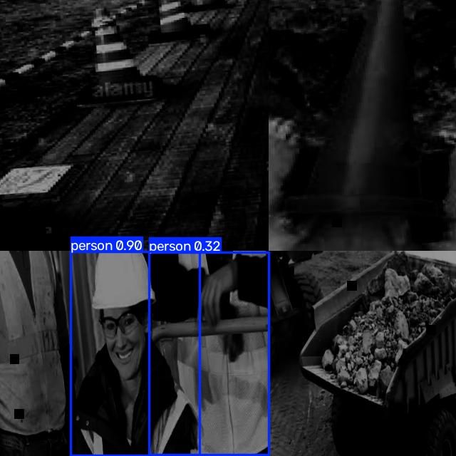
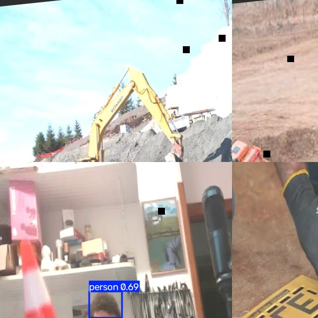
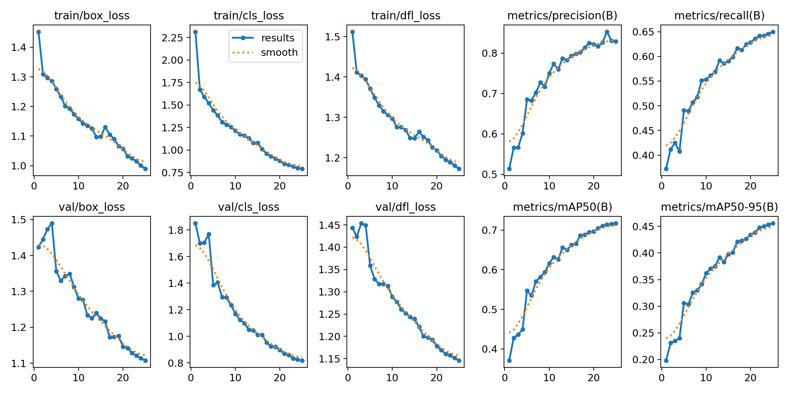
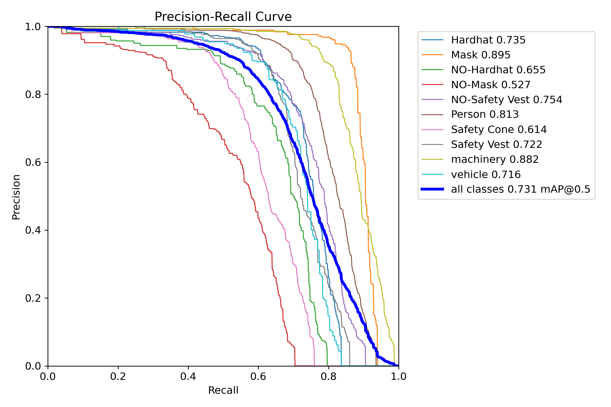
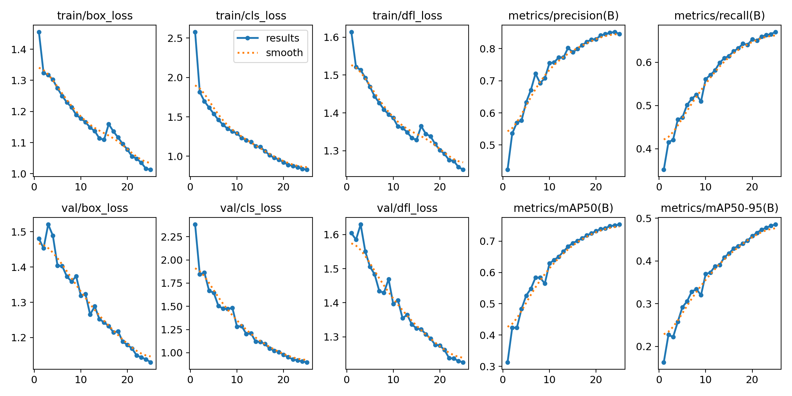

# Лабораторная работа №3: обнаружение СИЗ с YOLOv8

Дата начала: 2026-10-28. Ветка: `lab/03-ppe`. Среда подготовки данных: Python 3.12.3, Pillow 10.2.0.

## Оглавление

- [Выполненные шаги](#выполненные-шаги)
- [Данные и ручная проверка](#данные-и-ручная-проверка)
- [Разбиение](#разбиение)
- [E0. Проверка предобученной модели](#e0-проверка-предобученной-модели)
  - [Сохранённые предсказания](#сохранённые-предсказания)
  - [Различия исходного и целевого доменов](#различия-исходного-и-целевого-доменов)
  - [Наблюдения по сохранённым изображениям](#наблюдения-по-сохранённым-изображениям)
- [E1. Базовое дообучение YOLOv8n](#e1-базовое-дообучение-yolov8n)
  - [Конфигурация и длительность](#конфигурация-и-длительность)
  - [Общие метрики](#общие-метрики)
  - [Матрица ошибок и порог уверенности](#матрица-ошибок-и-порог-уверенности)
- [E2. Увеличение разрешения до 960](#e2-увеличение-разрешения-до-960)
  - [Матрица ошибок и порог уверенности E2](#матрица-ошибок-и-порог-уверенности-e2)
  - [Сравнение классов на тесте](#сравнение-классов-на-тесте)
- [Системная оценка](#системная-оценка)
  - [Задержка полного вызова](#задержка-полного-вызова)
  - [Таблица системных метрик](#таблица-системных-метрик)
  - [Устойчивость к освещению, наклону и перекрытию](#устойчивость-к-освещению-наклону-и-перекрытию)
  - [Передача решения оператору](#передача-решения-оператору)
  - [Контроль сдвига данных и откат версии](#контроль-сдвига-данных-и-откат-версии)
- [Воспроизведение](#воспроизведение)
- [Следующие шаги](#следующие-шаги)

[Галерея ошибок](error-analysis/index.html) · [Минимальные тесты](../scripts/tests/test_ppe_minimum.py)

## Выполненные шаги

| Шаг | Результат |
| --- | --- |
| 2. Данные и разметка | Получен набор Roboflow Construction Site Safety v28 через Kaggle v3; 2801 изображение, 10 классов. Источник, лицензия и правила разметки описаны в [паспорте данных](../Construction-Site-Safety-PPE-Detection-main/data/README.md). |
| 2.1. Проверка разметки | Просмотрены 30 случайных кадров и 10 дополнительных с малыми объектами. Замечания по каждому кадру записаны в [журнале проверки](../Construction-Site-Safety-PPE-Detection-main/data/audit.csv); контактные листы — в [папке предпросмотра](../Construction-Site-Safety-PPE-Detection-main/data/audit_preview/). |
| 3. Разбиение без утечки | Созданы группы по имени первичного файла/ролика, сформировано новое разбиение 1961/420/420, тестовый список закреплён до экспериментов. Проверены пути, разметка, классы, имена, SHA-256, группы и визуально близкие кадры. |
| 4.1. E0 | Проверена предобученная YOLOv8n без дообучения на 10 валидационных изображениях; сохранены изображения, рамки и уверенность. Описаны различия COCO и целевого набора СИЗ. |
| 4.2. E1 | Завершено 25 эпох YOLOv8n, `imgsz=640`, `batch=16`, `seed=42`; на тесте mAP@0.5 = 0.72932 и mAP@0.5:0.95 = 0.46588. Параметры, графики и ограничения приведены в разделе E1. |

## Данные и ручная проверка

Источник: [Roboflow Universe Projects, версия 28](https://universe.roboflow.com/roboflow-universe-projects/construction-site-safety/dataset/28), копия [Snehil Sanyal на Kaggle, версия 3](https://www.kaggle.com/datasets/snehilsanyal/construction-site-safety-image-dataset-roboflow). Заявленная лицензия — CC BY 4.0; дата получения — 2026-10-28. Архив: SHA-256 `f1acf02c7116a09cdbb2b3ace1ee9b597977c0eb0bd0025e8949f81091fb2a3d`.

Изображения имеют размер 640×640. Все 2801 пары «изображение — `.txt`» читаются. В 24 файлах разметка пустая. У непустых строк правильный формат YOLO, номера классов 0–9 и нормированные координаты. Классы `NO-Hardhat`, `NO-Mask` и `NO-Safety Vest` представлены отдельными рамками области головы, лица и торса, а не отсутствием положительной рамки.

Ручная выборка воспроизводится начальным значением генератора 42. Проверялись пропуски и лишние рамки, класс, точность границ, обрезка, перекрытие, дубликаты и несовместимость источников. Часты составные кадры, сильное изменение освещения и сцены вне стройплощадки. Двадцать кадров помечены для повторной проверки в редакторе: маленькие или тёмные объекты нельзя уверенно исправить по доступным пикселям. Исходные рамки не менялись без уверенности.

## Разбиение

Исходное разбиение поставщика: 2605/114/82. В нём 21 предварительная группа пересекала две или три части. Для нового разбиения варианты одного исходного имени и кадры с общим именем ролика объединены; 716 файлов `youtube-*` без идентификатора ролика оставлены одной группой в обучении. Всего 395 групп. Применён детерминированный поиск разбиения с начальным значением 42: приоритет — целостность группы и баланс числа объектов по классам.

| Класс | Обучение | Проверка | Тест |
| --- | ---: | ---: | ---: |
| Каска | 2305 | 515 | 514 |
| Маска | 1172 | 263 | 265 |
| Без каски | 1686 | 377 | 364 |
| Без маски | 2277 | 497 | 476 |
| Без сигнального жилета | 2884 | 637 | 637 |
| Человек | 6909 | 1510 | 1453 |
| Сигнальный конус | 2376 | 524 | 602 |
| Сигнальный жилет | 2226 | 459 | 450 |
| Рабочая техника | 3740 | 817 | 789 |
| Транспорт | 1160 | 260 | 208 |
| **Изображений** | **1961** | **420** | **420** |
| **Групп** | **252** | **69** | **74** |

Списки и назначение файлов: [списки частей](../Construction-Site-Safety-PPE-Detection-main/data/splits/) и [манифест разбиения](../Construction-Site-Safety-PPE-Detection-main/data/split_manifest.csv). Тестовый список заморожен; его SHA-256: `5cabc10fa036fbda26aebce5a7b382479c30b925df6493c64b239ffb3329befe`. [Конфигурация обучения](../configs/ppe.yaml) содержит пути и имена классов.

Проверка `python3 scripts/validate_ppe_split.py --check-near-duplicates` прошла: ноль пересечений имён, SHA-256 и идентификаторов групп; все изображения и метки доступны; каждый класс есть в каждой части. Между частями не найдено пар с расстоянием dHash ≤ 5 бит.

**Ограничение:** источник не указывает первичные кадры каждой mosaic-аугментации и точный ролик для большинства `youtube-*`. Поэтому отсутствие общих исходных сцен не доказано полностью. В тесте 390 изображений происходят из исходной обучающей части поставщика, где применялись аугментации; итоговую метрику нужно трактовать с учётом этого. Три кадра теста, попавшие в ручной аудит, имеют сомнительные мелкие метки и отмечены для дальнейшей проверки.

## E0. Проверка предобученной модели

Без дообучения применена модель `Construction-Site-Safety-PPE-Detection-main/models/yolov8n.pt`. Скрипт [experiments/e0.py](../experiments/e0.py) выбирает 10 изображений из замороженной валидационной выборки `data/splits/val.txt` с начальным значением генератора 42. Пути содержат исходные папки поставщика `raw/train` и `raw/test`, но принадлежность к новой выборке определяется сохранённым разбиением лабораторной. Ни один из выбранных кадров не входит в замороженный тест лабораторной.

Параметры применения: `imgsz=640`, `conf=0.25`, устройство `cpu`; сохранение изображений, текстовых рамок и уверенности включено (`save=True`, `save_txt=True`, `save_conf=True`). Для воспроизведения из корня проекта: `venv/bin/python experiments/e0.py`. Ultralytics при занятом имени выходной папки создаёт следующую папку с числовым суффиксом.

### Сохранённые предсказания

Все 10 изображений с рамками доступны в [папке E0](e0/), точный состав выборки — в [selected_images.txt](e0/selected_images.txt), численные результаты — в [labels/](e0/labels/). Каждая строка результата содержит `class_id cx cy width height confidence`; координаты нормированы. Номера классов здесь относятся к **COCO**, а не к словарю из `configs/ppe.yaml`: например, 0 означает `person`, тогда как в наборе СИЗ номер 0 соответствует каске.

При пороге уверенности 0.25 сохранено 40 предсказанных рамок:

| Класс COCO | Число предсказаний |
| --- | ---: |
| person | 25 |
| car | 2 |
| bus | 2 |
| train | 2 |
| truck | 4 |
| boat | 2 |
| potted plant | 1 |
| dining table | 1 |
| refrigerator | 1 |
| **Всего** | **40** |

Это число предсказаний, а не число верных обнаружений: автоматическое сопоставление с эталонными рамками в E0 не выполнялось.

### Различия исходного и целевого доменов

Согласно [документации Ultralytics](https://docs.ultralytics.com/models/yolov8/), исходные веса YOLOv8n для обнаружения объектов обучены на COCO с 80 классами. COCO охватывает разнообразные повседневные сцены и общие категории, включая людей и транспорт. Модель не обучена выдавать классы `Hardhat`, `Mask`, `Safety Vest`, соответствующие `NO-*`, `Safety Cone` и `machinery` из нашей разметки. Отсутствие предсказания каски у этой модели прежде всего связано с отсутствием такого выходного класса, а не доказывает влияние освещения или размера объекта.

| Аспект | Исходное обучение на COCO | Целевые данные строительной площадки |
| --- | --- | --- |
| Задача и классы | Общие категории: человек, автомобиль, грузовик и другие объекты. | 10 классов, включая СИЗ, отдельные рамки головы/лица/торса без СИЗ, строительную технику и транспорт. |
| Масштаб и область объекта | Рамка человека относится к человеку, без отдельного решения о наличии СИЗ. | Каска и маска занимают небольшую часть кадра; рамки СИЗ и `NO-*` могут сосуществовать с рамкой человека. |
| Условия целевой съёмки | Разнообразные сцены COCO не задают специализацию на конкретной стройплощадке. | В наборе присутствуют дальние планы, перекрытия, обрезка, тёмные и пересвеченные изображения, необычные ракурсы. |
| Подготовка целевых изображений | Исходная модель применяется без адаптации к этому набору. | Помимо кадров площадок есть посторонние сцены, mosaic-изображения, чёрные области cutout и изменения яркости. Это свойства учебного набора, а не обязательные условия реальной камеры. |

### Наблюдения по сохранённым изображениям

1. На тёмном составном кадре `707_jpg.rf.bca714d4d4b04e93b580bf480cd071de.jpg` найдены две рамки `person` с уверенностью около 0.90 и 0.32. Модель выделяет людей, но не выдаёт решения о каске или жилете. Различная уверенность сама по себе не доказывает причину ошибки; кадр иллюстрирует сложное освещение и составное изображение.

   

2. В кадре `image_246_jpg.rf.95dc4339438bd272b9a2d2221e77945d.jpg` видны экскаватор и сигнальный конус, однако сохранена только одна рамка `person` с уверенностью около 0.69. У COCO нет целевых классов `machinery` и `Safety Cone`, поэтому исходная модель не решает требуемую задачу для этих объектов.

   

3. В составном кадре `IMG_0871_mp4-24_jpg.rf.f9e7803a7755260449de41f00a63c0a0.jpg` обнаружены три рамки `person`, включая перекрывающиеся рамки в верхнем левом фрагменте. Маски видны на изображении, но отдельного класса маски в выходном словаре модели нет.

   

**Вывод E0:** предобученная модель переносит общие признаки людей и транспорта, но для обнаружения СИЗ требуется адаптация к целевому словарю классов и данным. E1 выполнен как базовое дообучение на сохранённой обучающей выборке; E2 предназначен для проверки одного изменения конфигурации. Прямой расчёт mAP E0 по числовым идентификаторам десяти классов СИЗ некорректен: словари классов различаются. Выборка из десяти кадров, в том числе производных близких сцен, используется только для качественной проверки.

Проверено: наличие 10 выходных изображений и 10 файлов рамок, размер изображений 640×640, воспроизводимость состава выборки, отсутствие пересечения с тестом, шесть полей в строке предсказания, допустимые классы COCO, нормированные координаты и уверенность не ниже 0.25.

## E1. Базовое дообучение YOLOv8n

Журнал завершённого запуска E1 содержит 25 эпох и отдельную оценку на тесте. [Материалы запуска](../runs/ppe/e1-opora-colab-2/) · [Скрипт запуска](../experiments/e1.py) · [Настройки обучения](../runs/ppe/e1-opora-colab-2/args.yaml)

### Конфигурация и длительность

| Параметр | Значение |
| --- | --- |
| Начальные веса | Предобученные `models/yolov8n.pt`, без продолжения предыдущего обучения (`resume=False`). |
| Набор данных | `configs/ppe.yaml`, 10 классов; 1961/420/420 изображений в обучении/валидации/тесте. |
| Число эпох | 25, выполнены все запланированные эпохи. |
| Размер изображения / пакет | `imgsz=640`, `batch=16`. |
| Воспроизводимость | `seed=42`, `deterministic=True`. |
| Устройство / точность | `device=0`, `amp=True`. |
| Оптимизация | `optimizer=auto`, `lr0=0.01`, `lrf=0.01`, `weight_decay=0.0005`; фактические скорости обучения приведены в CSV. |
| Аугментации | `mosaic=1.0`, `close_mosaic=10`, `scale=0.5`, `translate=0.1`, `fliplr=0.5`; полный набор параметров — в `args.yaml`. |
| Время обучения по журналу | 758.963 с, около 12 мин 39 с. |
| Сохранённые веса | [best.pt](../runs/ppe/e1-opora-colab-2/weights/best.pt) и [last.pt](../runs/ppe/e1-opora-colab-2/weights/last.pt). |

**Отклонение от примера задания:** число эпох уменьшено с 50 до 25.

Для GPU-окружения подготовлен [requirements-rocm.txt](../requirements-rocm.txt): Python 3.14, Ultralytics 8.4.191, PyTorch 2.14.0+rocm10.0.0 и torchvision 0.29.0+rocm10.0.0, целевая видеокарта AMD RX 6600 (`gfx1032`). Это описание окружения из файла зависимостей; отдельный снимок оборудования и версий непосредственно во время запуска не сохранён. CPU-окружение из `requirements.txt` не следует смешивать с этим набором пакетов.

### Общие метрики

Валидационные значения взяты из 25-й эпохи, в которой достигнут максимальный валидационный mAP@0.5:0.95. На тесте оценены лучшие сохранённые веса. Значения ниже приведены в долях единицы. [Журнал обучения](../runs/ppe/e1-opora-colab-2/results.csv) · [Тестовые метрики](../runs/ppe/e1-opora-colab-2/test/metrics.json)

| Метрика | Валидация | Тест |
| --- | ---: | ---: |
| Precision | 0.82902 | 0.83745 |
| Recall | 0.65004 | 0.65744 |
| mAP@0.5 | 0.71695 | 0.73125 |
| mAP@0.5:0.95 | 0.45574 | 0.46577 |

### Матрица ошибок и порог уверенности

Зависимость от порога уверенности: [precision](../runs/ppe/e1-opora-colab-2/test/BoxP_curve.png), [recall](../runs/ppe/e1-opora-colab-2/test/BoxR_curve.png), [F1](../runs/ppe/e1-opora-colab-2/test/BoxF1_curve.png).

**Вывод E1:** базовая модель даёт mAP@0.5 **73.12%**, но recall **65.74%**: часть объектов пропускается. Слабее всего классы `NO-Mask` (AP@0.5 = 0.527) и `Safety Cone` (0.614). На матрице ошибок доля несопоставленных эталонных рамок для них составляет примерно 0.24 и 0.21. Модель служит точкой сравнения для E2.

## E2. Увеличение разрешения до 960

Источники чисел: [журнал обучения](../runs/ppe/e2-img960-colab-2/results.csv), [тестовые метрики](../runs/ppe/e2-img960-colab-2/test/metrics.json), [параметры](../runs/ppe/e2-img960-colab-2/args.yaml).

| Метрика | Валидация | Тест |
| --- | ---: | ---: |
| Precision | 0.84578 | 0.84975 |
| Recall | 0.67024 | 0.68318 |
| mAP@0.5 | 0.75350 | 0.77158 |
| mAP@0.5:0.95 | 0.48564 | 0.49451 |

### Матрица ошибок и порог уверенности E2

Зависимость от порога уверенности: [precision](../runs/ppe/e2-img960-colab-2/test/BoxP_curve.png), [recall](../runs/ppe/e2-img960-colab-2/test/BoxR_curve.png), [F1](../runs/ppe/e2-img960-colab-2/test/BoxF1_curve.png).

**Вывод E2:** mAP@0.5 вырос до **77.16%**, recall — до **68.32%**. Особенно улучшились `NO-Mask` (AP@0.5: 0.527 → 0.637) и `Safety Cone` (0.614 → 0.696). Это согласуется с гипотезой о пользе большего разрешения, но эффект именно на малых объектах отдельно не измерен. По матрице ошибок пропуски `NO-Mask` и `Safety Cone` всё ещё заметны (примерно 0.15 и 0.12).

### Сравнение классов на тесте

Precision, recall и AP взяты из сохранённого вывода Ultralytics при оценке E1 и E2 на 420 тестовых кадрах. Значения приведены в долях единицы с точностью до трёх знаков. [Вывод ноутбука Colab](../experiments/e1_e2_colab.ipynb)

| Класс | Объектов в оценке | E1 Precision | E1 Recall | E1 AP@0.5 | E1 AP@0.5:0.95 | E2 Precision | E2 Recall | E2 AP@0.5 | E2 AP@0.5:0.95 |
| --- | ---: | ---: | ---: | ---: | ---: | ---: | ---: | ---: | ---: |
| Hardhat | 514 | 0.860 | 0.638 | 0.735 | 0.429 | 0.913 | 0.702 | 0.785 | 0.466 |
| Mask | 265 | 0.908 | 0.864 | 0.895 | 0.621 | 0.939 | 0.842 | 0.894 | 0.655 |
| NO-Hardhat | 364 | 0.821 | 0.579 | 0.655 | 0.371 | 0.803 | 0.594 | 0.682 | 0.403 |
| NO-Mask | 476 | 0.741 | 0.445 | 0.527 | 0.218 | 0.822 | 0.534 | 0.637 | 0.274 |
| NO-Safety Vest | 637 | 0.837 | 0.673 | 0.754 | 0.470 | 0.824 | 0.669 | 0.769 | 0.475 |
| Person | 1453 | 0.873 | 0.725 | 0.813 | 0.589 | 0.867 | 0.751 | 0.834 | 0.602 |
| Safety Cone | 602 | 0.766 | 0.548 | 0.614 | 0.302 | 0.814 | 0.602 | 0.696 | 0.349 |
| Safety Vest | 450 | 0.869 | 0.636 | 0.722 | 0.446 | 0.837 | 0.678 | 0.778 | 0.489 |
| machinery | 788 | 0.884 | 0.808 | 0.882 | 0.696 | 0.877 | 0.796 | 0.882 | 0.692 |
| vehicle | 208 | 0.815 | 0.658 | 0.716 | 0.516 | 0.802 | 0.663 | 0.759 | 0.540 |

В исходном тестовом разбиении 5758 рамок. При чтении меток Ultralytics исключил одну дублирующую рамку класса `machinery`, поэтому в расчёт обеих моделей вошли 5757 рамок. Для класса «без каски» у E2 полнота выросла с 57.9% до 59.4%, а точность снизилась с 82.1% до 80.3%.

На одном тестовом разбиении E2 выше E1 на **4.03 процентного пункта** по mAP@0.5 и на **2.87 пункта** по mAP@0.5:0.95. Для `Mask` и `machinery` значения AP@0.5 почти совпадают.

Контрольная сумма замороженного тестового списка при внесении результатов совпала с сохранённой. Оговорки о происхождении и аугментациях данных из раздела разбиения сохраняются.

## Системная оценка

### Задержка полного вызова

Задержка полного вызова — время обработки одного изображения от начала чтения файла до получения списка объектов. В замер входят чтение и декодирование, изменение размера при необходимости, подготовка входа, прямой проход модели, фильтрация рамок с помощью NMS и перенос результата с GPU на CPU. Скрипт синхронизирует GPU перед запуском и после вызова, чтобы учесть выполнение вычислений. [Скрипт измерения](../scripts/evaluate_ppe_system.py)

Обе модели запускались на AMD Radeon RX 6600 с вычислениями в FP32. После 10 прогревочных вызовов скрипт последовательно обработал 420 тестовых кадров по одному. Таймер `perf_counter()` выдаёт время в секундах. Разность показаний умножается на 1000, поэтому задержка приведена в **миллисекундах на изображение**. Значения для отдельных кадров сохранены в столбце `total_ms`, а сводные показатели — в поле `timings_ms.total_ms` для каждой модели. [Замеры по кадрам](system-evaluation/timings.csv) · [Сводные показатели](system-evaluation/metrics.json)

### Таблица системных метрик

| Системная метрика | Что означает | Единица измерения | E1 (640 × 640) | E2 (960 × 960) |
| --- | --- | --- | ---: | ---: |
| Медиана задержки | Половина кадров обработана за это время или быстрее | мс на кадр | 13,20 | 19,84 |
| p95 задержки | Около 95% кадров обработано за это время или быстрее | мс на кадр | 15,12 | 22,51 |
| Последовательная пропускная способность | Число кадров, делённое на суммарное время их обработки | кадров/с | 74,99 | 51,69 |
| Пик выделенной памяти GPU | Максимальный объём памяти GPU, выделенной PyTorch для тензоров | МБ | 45,01 | 60,71 |
| Пик зарезервированной памяти GPU | Максимальный объём памяти GPU в пуле PyTorch, включая свободный запас внутри пула | МБ | 62,91 | 81,79 |
| Пик RSS по замерам | Наибольший зафиксированный объём оперативной памяти, занимаемой процессом | МБ | 1368,93 | 1371,99 |
| Частота ложных тревог | Число предсказаний нарушения без пары в разметке в пересчёте на 100 кадров. На одном кадре может быть несколько таких тревог | тревог на 100 кадров | 79,05 | 88,33 |

В ложные тревоги входят несопоставленные предсказания классов «без каски», «без маски» и «без жилета» при пороге уверенности 0,25 и пороге IoU сопоставления 0,50. [Сводные показатели](system-evaluation/metrics.json) · [Код подсчёта](../scripts/evaluate_ppe_system.py)

### Устойчивость к освещению, наклону и перекрытиюд

Из замороженного тестового списка случайно отобрали 60 кадров с `seed=42`. Обе модели обработали одни и те же кадры в пяти вариантах. При затемнении и осветлении интенсивность пикселей умножили на 0,5 или 1,5. При перекрытии закрыли левую половину выбранной рамки. В первую очередь выбирали самую крупную рамку класса «без каски». Наклон имитировали поворотом на 15° в плоскости изображения и пересчитали координаты эталонных рамок. Такой поворот проверяет наклон кадра. Для проверки смены ракурса в пространстве понадобились бы кадры с других точек съёмки. [Код преобразований](../scripts/evaluate_ppe_system.py) · [Пример преобразований](system-evaluation/robustness-preview.jpg)

Полнота показывает долю найденных эталонных объектов при пороге уверенности 0,25 и IoU сопоставления от 0,50. Общая полнота рассчитана по суммарным числам найденных и пропущенных объектов. Для класса «без каски» рядом с процентом указано число найденных рамок из числа эталонов. [Результаты по кадрам](system-evaluation/robustness.csv) · [Сводные показатели](system-evaluation/metrics.json)

| Условие | E1, общая полнота | E2, общая полнота | E1, полнота «без каски» | E2, полнота «без каски» |
| --- | ---: | ---: | ---: | ---: |
| Исходные кадры | 67,36% | 71,15% | 58,46% (38 из 65) | 64,62% (42 из 65) |
| Затемнение × 0,5 | 67,24% | 70,92% | 61,54% (40 из 65) | 61,54% (40 из 65) |
| Осветление × 1,5 | 61,72% | 64,83% | 55,38% (36 из 65) | 58,46% (38 из 65) |
| Наклон на 15° | 45,41% | 48,94% | 40,32% (25 из 62) | 41,94% (26 из 62) |
| Частичное перекрытие | 58,74% | 62,41% | 15,38% (10 из 65) | 20,00% (13 из 65) |

Для обеих моделей общая полнота сильнее всего упала при наклоне. Самым трудным условием для класса «без каски» стало перекрытие. У E2 полнота этого класса снизилась с 64,62% до 20,00%.

### Передача решения оператору

Предлагаемое правило для пилотного применения. Если голова человека перекрыта, обрезана или плохо видна из-за освещения, система помечает случай как «требуется проверка». Такой же статус нужен, если для одного человека получены противоречивые рамки «каска» и «без каски» либо модель не выдала пригодного ответа о каске. Отсутствие рамки «без каски» оставляет статус СИЗ неопределённым.

Оператору передаются кадр с рамками, время, идентификатор камеры и причина передачи. Оператор подтверждает или отклоняет сигнал, а при плохой видимости проверяет соседние кадры или другую камеру. Решение о допуске к работе принимает ответственный сотрудник. В лабораторной проверялся детектор на сохранённых изображениях. Это правило описывает порядок работы для пилота.

### Контроль сдвига данных и откат версии

До пилота для каждой камеры собирается эталонный набор кадров с обычными условиями съёмки и фиксируются показатели качества. В работе с камерой сравниваются яркость кадров, размеры обнаруженных объектов и количество тревог на 100 кадров с эталонным периодом. На выборке, которую проверил оператор, отдельно оцениваются полнота класса «без каски» и частота ложных тревог. Изменение яркости или числа тревог служит поводом проверить свежие кадры. Смена камеры, ракурса, освещения или условий на площадке отмечается в журнале.

При подтверждённом ухудшении после обновления применяется следующая схема отката:

1. Перевести спорные случаи на ручную проверку и зафиксировать камеру, время и версию модели.
2. Восстановить последнюю проверенную версию целиком, включая веса, размер входа, пороги уверенности и NMS. Сверить контрольную сумму весов.
3. Проверить восстановленную версию на контрольных кадрах и размеченных кадрах с камеры. Возобновить обработку после проверки полноты критичного класса, ложных тревог и задержки. Если ухудшение сохраняется, оставить ручную проверку и исследовать изменения условий съёмки.

В лабораторной пути к весам и их SHA-256, размеры входа и пороги сохранены вместе с системными замерами. Схема мониторинга и отката предназначена для пилота. [Параметры и версии весов](system-evaluation/metrics.json)

## Воспроизведение

Из корня репозитория: `python3 scripts/download_ppe_data.py`, затем `python3 scripts/profile_ppe_data.py`, `python3 scripts/split_ppe_data.py`, `python3 scripts/validate_ppe_split.py --check-near-duplicates`. Скрипт разбиения повторно использует существующий `split_manifest.csv` и проверяет контрольную сумму тестового списка. Ссылки в `Construction-Site-Safety-PPE-Detection-main/data/processed/` и абсолютный путь в `configs/ppe.yaml` пересоздаются для текущей машины.

## Следующие шаги

Следующий эксперимент — сравнить полноту E1 и E2 отдельно по группам размеров эталонных рамок. Параметры эксперимента следует зафиксировать до повторного запуска на замороженном тестовом списке.
