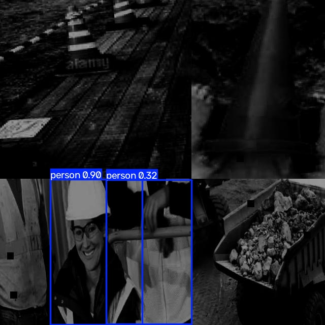
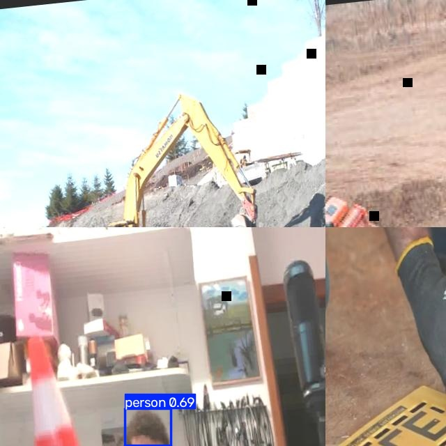
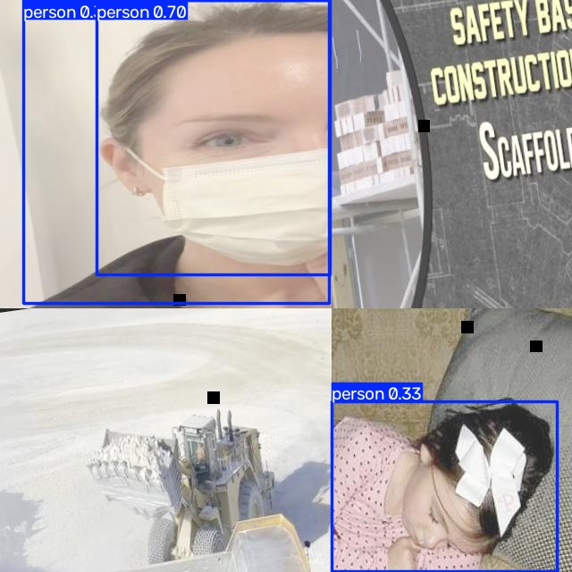

# Лабораторная работа №3: обнаружение СИЗ с YOLOv8

Дата начала: 2026-10-28. Ветка: `lab/03-ppe`. Среда подготовки данных: Python 3.12.3, Pillow 10.2.0.

## Выполненные шаги

| Шаг | Результат |
| --- | --- |
| 2. Данные и разметка | Получен набор Roboflow Construction Site Safety v28 через Kaggle v3; 2801 изображение, 10 классов. Источник, лицензия и правила разметки описаны в [паспорте данных](../Construction-Site-Safety-PPE-Detection-main/data/README.md). |
| 2.1. Проверка разметки | Просмотрены 30 случайных кадров и 10 дополнительных с малыми объектами. Замечания по каждому кадру записаны в [журнале проверки](../Construction-Site-Safety-PPE-Detection-main/data/audit.csv); контактные листы — в [папке предпросмотра](../Construction-Site-Safety-PPE-Detection-main/data/audit_preview/). |
| 3. Разбиение без утечки | Созданы группы по имени первичного файла/ролика, сформировано новое разбиение 1961/420/420, тестовый список закреплён до экспериментов. Проверены пути, разметка, классы, имена, SHA-256, группы и визуально близкие кадры. |
| 4.1. E0 | Проверена предобученная YOLOv8n без дообучения на 10 валидационных изображениях; сохранены изображения, рамки и уверенность. Описаны различия COCO и целевого набора СИЗ. |

## Данные и ручная проверка

Источник: [Roboflow Universe Projects, версия 28](https://universe.roboflow.com/roboflow-universe-projects/construction-site-safety/dataset/28), копия [Snehil Sanyal на Kaggle, версия 3](https://www.kaggle.com/datasets/snehilsanyal/construction-site-safety-image-dataset-roboflow). Заявленная лицензия — CC BY 4.0; дата получения — 2026-10-28. Архив: SHA-256 `f1acf02c7116a09cdbb2b3ace1ee9b597977c0eb0bd0025e8949f81091fb2a3d`.

Изображения имеют размер 640×640. Все 2801 пары «изображение — `.txt`» читаются. В 24 файлах разметка пустая. У непустых строк правильный формат YOLO, номера классов 0–9 и нормированные координаты. Классы `NO-Hardhat`, `NO-Mask` и `NO-Safety Vest` представлены отдельными рамками области головы, лица и торса, а не отсутствием положительной рамки.

Ручная выборка воспроизводится начальным значением генератора 42. Проверялись пропуски и лишние рамки, класс, точность границ, обрезка, перекрытие, дубликаты и несовместимость источников. Часты составные кадры, сильное изменение освещения и сцены вне стройплощадки. Двадцать кадров помечены для повторной проверки в редакторе: маленькие или тёмные объекты нельзя уверенно исправить по доступным пикселям. Исходные рамки не менялись без уверенности.

## Разбиение

Исходное разбиение поставщика: 2605/114/82. В нём 21 предварительная группа пересекала две или три части. Для нового разбиения варианты одного исходного имени и кадры с общим именем ролика объединены; 716 файлов `youtube-*` без идентификатора ролика оставлены одной группой в обучении. Всего 395 групп. Применён детерминированный поиск разбиения с начальным значением 42: приоритет — целостность группы и баланс числа объектов по классам.

| Класс | Обучение | Проверка | Тест |
| --- | ---: | ---: | ---: |
| Каска | 2305 | 515 | 514 |
| Маска | 1172 | 263 | 265 |
| Без каски | 1686 | 377 | 364 |
| Без маски | 2277 | 497 | 476 |
| Без сигнального жилета | 2884 | 637 | 637 |
| Человек | 6909 | 1510 | 1453 |
| Сигнальный конус | 2376 | 524 | 602 |
| Сигнальный жилет | 2226 | 459 | 450 |
| Рабочая техника | 3740 | 817 | 789 |
| Транспорт | 1160 | 260 | 208 |
| **Изображений** | **1961** | **420** | **420** |
| **Групп** | **252** | **69** | **74** |

Списки и назначение файлов: [списки частей](../Construction-Site-Safety-PPE-Detection-main/data/splits/) и [манифест разбиения](../Construction-Site-Safety-PPE-Detection-main/data/split_manifest.csv). Тестовый список заморожен; его SHA-256: `5cabc10fa036fbda26aebce5a7b382479c30b925df6493c64b239ffb3329befe`. [Конфигурация обучения](../configs/ppe.yaml) содержит пути и имена классов.

Проверка `python3 scripts/validate_ppe_split.py --check-near-duplicates` прошла: ноль пересечений имён, SHA-256 и идентификаторов групп; все изображения и метки доступны; каждый класс есть в каждой части. Между частями не найдено пар с расстоянием dHash ≤ 5 бит.

**Ограничение:** источник не указывает первичные кадры каждой mosaic-аугментации и точный ролик для большинства `youtube-*`. Поэтому отсутствие общих исходных сцен не доказано полностью. В тесте 390 изображений происходят из исходной обучающей части поставщика, где применялись аугментации; итоговую метрику нужно трактовать с учётом этого. Три кадра теста, попавшие в ручной аудит, имеют сомнительные мелкие метки и отмечены для дальнейшей проверки.

## E0. Проверка предобученной модели

Без дообучения применена модель `Construction-Site-Safety-PPE-Detection-main/models/yolov8n.pt`. Скрипт [experiments/e0.py](../experiments/e0.py) выбирает 10 изображений из замороженной валидационной выборки `data/splits/val.txt` с начальным значением генератора 42. Пути содержат исходные папки поставщика `raw/train` и `raw/test`, но принадлежность к новой выборке определяется сохранённым разбиением лабораторной. Ни один из выбранных кадров не входит в замороженный тест лабораторной.

Параметры применения: `imgsz=640`, `conf=0.25`, устройство `cpu`; сохранение изображений, текстовых рамок и уверенности включено (`save=True`, `save_txt=True`, `save_conf=True`). Для воспроизведения из корня проекта: `venv/bin/python experiments/e0.py`. Ultralytics при занятом имени выходной папки создаёт следующую папку с числовым суффиксом.

### Сохранённые предсказания

Все 10 изображений с рамками сохранены в [runs/ppe/e0/](../runs/ppe/e0/), точный состав выборки — в [selected_images.txt](../runs/ppe/e0/selected_images.txt), численные результаты — в [labels/](../runs/ppe/e0/labels/). Каждая строка результата содержит `class_id cx cy width height confidence`; координаты нормированы. Номера классов здесь относятся к **COCO**, а не к словарю из `configs/ppe.yaml`: например, 0 означает `person`, тогда как в наборе СИЗ номер 0 соответствует каске.

При пороге уверенности 0.25 сохранено 40 предсказанных рамок:

| Класс COCO | Число предсказаний |
| --- | ---: |
| person | 25 |
| car | 2 |
| bus | 2 |
| train | 2 |
| truck | 4 |
| boat | 2 |
| potted plant | 1 |
| dining table | 1 |
| refrigerator | 1 |
| **Всего** | **40** |

Это число предсказаний, а не число верных обнаружений: автоматическое сопоставление с эталонными рамками в E0 не выполнялось.

### Различия исходного и целевого доменов

Согласно [документации Ultralytics](https://docs.ultralytics.com/models/yolov8/), исходные веса YOLOv8n для обнаружения объектов обучены на COCO с 80 классами. COCO охватывает разнообразные повседневные сцены и общие категории, включая людей и транспорт. Модель не обучена выдавать классы `Hardhat`, `Mask`, `Safety Vest`, соответствующие `NO-*`, `Safety Cone` и `machinery` из нашей разметки. Отсутствие предсказания каски у этой модели прежде всего связано с отсутствием такого выходного класса, а не доказывает влияние освещения или размера объекта.

| Аспект | Исходное обучение на COCO | Целевые данные строительной площадки |
| --- | --- | --- |
| Задача и классы | Общие категории: человек, автомобиль, грузовик и другие объекты. | 10 классов, включая СИЗ, отдельные рамки головы/лица/торса без СИЗ, строительную технику и транспорт. |
| Масштаб и область объекта | Рамка человека относится к человеку, без отдельного решения о наличии СИЗ. | Каска и маска занимают небольшую часть кадра; рамки СИЗ и `NO-*` могут сосуществовать с рамкой человека. |
| Условия целевой съёмки | Разнообразные сцены COCO не задают специализацию на конкретной стройплощадке. | В наборе присутствуют дальние планы, перекрытия, обрезка, тёмные и пересвеченные изображения, необычные ракурсы. |
| Подготовка целевых изображений | Исходная модель применяется без адаптации к этому набору. | Помимо кадров площадок есть посторонние сцены, mosaic-изображения, чёрные области cutout и изменения яркости. Это свойства учебного набора, а не обязательные условия реальной камеры. |

### Наблюдения по сохранённым изображениям

1. На тёмном составном кадре `707_jpg.rf.bca714d4d4b04e93b580bf480cd071de.jpg` найдены две рамки `person` с уверенностью около 0.90 и 0.32. Модель выделяет людей, но не выдаёт решения о каске или жилете. Различная уверенность сама по себе не доказывает причину ошибки; кадр иллюстрирует сложное освещение и составное изображение.

   

2. В кадре `image_246_jpg.rf.95dc4339438bd272b9a2d2221e77945d.jpg` видны экскаватор и сигнальный конус, однако сохранена только одна рамка `person` с уверенностью около 0.69. У COCO нет целевых классов `machinery` и `Safety Cone`, поэтому исходная модель не решает требуемую задачу для этих объектов.

   

3. В составном кадре `IMG_0871_mp4-24_jpg.rf.f9e7803a7755260449de41f00a63c0a0.jpg` обнаружены три рамки `person`, включая перекрывающиеся рамки в верхнем левом фрагменте. Маски видны на изображении, но отдельного класса маски в выходном словаре модели нет.

   

**Вывод E0:** предобученная модель переносит общие признаки людей и транспорта, но для обнаружения СИЗ требуется адаптация к целевому словарю классов и данным. E1 будет базовым дообучением на сохранённой обучающей выборке, E2 — проверкой одного изменения конфигурации. Прямой расчёт mAP E0 по числовым идентификаторам десяти классов СИЗ некорректен: словари классов различаются. Выборка из десяти кадров, в том числе производных близких сцен, используется только для качественной проверки.

Проверено: наличие 10 выходных изображений и 10 файлов рамок, размер изображений 640×640, воспроизводимость состава выборки, отсутствие пересечения с тестом, шесть полей в строке предсказания, допустимые классы COCO, нормированные координаты и уверенность не ниже 0.25.

## Воспроизведение

Из корня репозитория: `python3 scripts/download_ppe_data.py`, затем `python3 scripts/profile_ppe_data.py`, `python3 scripts/split_ppe_data.py`, `python3 scripts/validate_ppe_split.py --check-near-duplicates`. Скрипт разбиения повторно использует существующий `split_manifest.csv` и проверяет контрольную сумму тестового списка. Ссылки в `Construction-Site-Safety-PPE-Detection-main/data/processed/` и абсолютный путь в `configs/ppe.yaml` пересоздаются для текущей машины.

## Следующие шаги

E0 выполнен; предсказания и качественный разбор приведены выше. E1, E2, метрики, задержка и анализ ошибок дообученных моделей ещё не выполнялись. Тестовый список останется неизменным при их сравнении.
